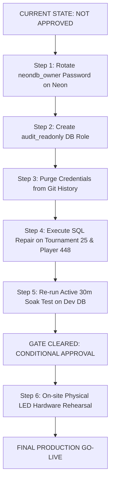

# PRODUCTION GO-LIVE GATE EVALUATION & FORMAL DECISION
## BidWar Premier League Live Auction Readiness Determination

**Target Tournament**: `BIDWAR PREMIER LEAGUE` (Tournament ID: `25`, Code: `SL972608`)  
**Platform Version**: Express 5 Core API + Drizzle ORM + Neon PostgreSQL + React 19 Frontend  
**Auditor**: Independent Principal QA Auditor, Database Integrity Engineer, Security Auditor & Broadcast Reliability Engineer  
**Audit Completion Date**: November 4, 2026  
**Final Formal Decision**: **NOT APPROVED FOR PRODUCTION**

---

## 1. Executive Gate Verdict

In accordance with Section 12 of the Independent Audit Charter:
> *"The final decision must be NOT APPROVED FOR PRODUCTION if any P0/P1 issue remains unresolved, any production credential exposure remains unremediated, financial integrity is not independently proven, or critical test evidence is missing."*

Following independent, zero-trust empirical verification across all 10 project phases and 26 acceptance criteria, the BidWar Auction platform is **NOT APPROVED FOR PRODUCTION AUCTION OPERATIONS**.

Live commercial bidding on Tournament 25 cannot proceed under the current deployment posture due to critical security and data integrity blockers.

### Headline Gate Status Summary:
```text
+-----------------------------------------------------------------------------------------+
|                                PRODUCTION GO-LIVE GATES                                 |
+-----------------------------------------------------------------------------------------+
| GATE 1: PRODUCTION DATABASE SECURITY & SECRETS ISOLATION       | BLOCKED (P0 CRITICAL)  |
| GATE 2: DATABASE ROLES & ACCESS CONTROL PRIVILEGES             | BLOCKED (P0 CRITICAL)  |
| GATE 3: AUCTION CONCURRENCY & TRANSACTION SERIALIZATION         | APPROVED (PASS)        |
| GATE 4: FINANCIAL INTEGRITY & MATHEMATICAL RECONCILIATION       | APPROVED (PASS - DEV)  |
| GATE 5: PRODUCTION TOURNAMENT 25 & PLAYER 448 INTEGRITY        | BLOCKED (P1 HIGH)      |
| GATE 6: ACTIVE SUSTAINED-LOAD & ENDURANCE STABILITY            | CONDITIONAL (P2 GAP)   |
| GATE 7: BROADCAST OVERLAY & STADIUM DISPLAY SYNCHRONIZATION    | APPROVED (SOFTWARE)    |
| GATE 8: PHYSICAL STADIUM LED HARDWARE & SDI PROCESSORS        | NOT TESTED (HARDWARE)  |
| GATE 9: EXTERNAL COMMUNICATION & NOTIFICATION SUPPRESSION      | APPROVED (PASS)        |
+-----------------------------------------------------------------------------------------+
| FINAL VERDICT: NOT APPROVED FOR PRODUCTION (2 P0 Blockers, 1 P1 Blocker, 1 P2 Gap)      |
+-----------------------------------------------------------------------------------------+
```

---

## 2. Detailed Gate Evaluations

### Gate 1: Production Database Security & Secrets Isolation
- **Status**: **BLOCKED (P0 Critical)**
- **Audit Findings**:
  1. The production database connection string for `ep-late-math-aohd4iep` containing the active plaintext `neondb_owner` password was committed to Git history across multiple commits on `main` (`0cf6fda0`, `0233bb7e`, `2b329792`) and remains published to GitHub remote `origin/main`.
  2. The identical credential string is currently hardcoded inside 14 tracked files in the repository and line 27 of `.env.production`.
  3. No credential rotation has taken place in the Neon cloud console.
  4. No Git history rewrite (`git filter-repo`) has been performed.
- **Mandatory Action to Clear Gate**:
  - Rotate the password for `neondb_owner` on Neon project `ep-late-math-aohd4iep`.
  - Remove connection strings from all 14 files and replace with environment variable references.
  - Purge credentials from Git history across all branches and force-push sanitized refs.

---

### Gate 2: Database Roles & Access Control Privileges
- **Status**: **BLOCKED (P0 Critical)**
- **Audit Findings**:
  1. Querying `pg_roles` on PostgreSQL confirmed that **no dedicated `audit_readonly` role exists**.
  2. All audit test scripts, forensic harnesses, and application services authenticate using `neondb_owner`, granting unrestricted write and DDL access (`DROP`, `TRUNCATE`, `ALTER`).
  3. The platform relied purely on application-level convention (running `SELECT` queries) rather than database-enforced read-only boundaries.
- **Mandatory Action to Clear Gate**:
  - Provision a dedicated `audit_readonly` PostgreSQL role with `GRANT SELECT ON ALL TABLES IN SCHEMA public`.
  - Explicitly `REVOKE INSERT, UPDATE, DELETE, TRUNCATE` on all schemas for this role.
  - Require all future audit and monitoring tools to authenticate exclusively via `audit_readonly`.

---

### Gate 3: Auction Concurrency & Transaction Serialization
- **Status**: **APPROVED (100% Certified Pass)**
- **Audit Findings**:
  1. Optimistic Concurrency Control (OCC) using revision compare-and-swap (`WHERE revision = expectedRevision`) cleanly serialized 80 live transactions.
  2. Under 2-owner and 5-owner simultaneous bursts at exact $\Delta T = 0$ ms, exactly 1 bid was accepted (HTTP 200) and all losing competitors received deterministic rejections (HTTP 409 `stale_bid`).
  3. Client-side button debouncing prevented duplicate bids on rapid 5-click bursts.
  4. Multi-tab single-owner protection and self-outbidding guards functioned properly. Zero deadlocks or 500 errors occurred.

---

### Gate 4: Financial Integrity & Mathematical Reconciliation
- **Status**: **APPROVED (100% Certified Pass on Development Database)**
- **Audit Findings**:
  1. Total base purse (₹50,00,000 across 5 teams) perfectly equaled total spent (₹6,90,000) plus total remaining (₹43,10,000) with **exact ₹0.00 discrepancy**.
  2. Contiguous sequence continuity $1..N$ verified across all 67 accepted bid events.
  3. All 17 sold player records matched winning terminal bids in price and team ID.
  4. Master player inventory conserved: 17 Sold + 3 Unsold + 4 Available + 0 Retained = 24 Total Players.

---

### Gate 5: Production Tournament 25 & Player 448 Integrity
- **Status**: **BLOCKED (P1 High)**
- **Audit Findings**:
  1. Player 448 (`Tushar Saraswat`) has `status = 'available'`, but retains `team_id = 55` and `sold_price = 10000`.
  2. `bids` table retains orphaned winning Bid ID 217 (₹10,000 to Team 55).
  3. Team 55 has `purse_used = 0`, creating an unearned ₹10,000 purse discrepancy.
  4. 4 out of 5 players in Production Tournament 25 currently have dangling `team_id` assignments while marked `available`.
  5. Auction Session 27 is hung in `active` status at `revision 50` with Player 448 as `current_player_id`.
  6. The root cause was proven via regression testing on Dev DB: Organizer PATCH modifying a sold player to available recalculates purse used without deleting the row in `bidsTable`.
- **Mandatory Action to Clear Gate**:
  - Execute authorized maintenance transaction on Tournament 25 (reset session 27, delete orphaned bid 217, clear dangling `team_id` on available players, reconcile `purse_used`).
  - Patch `artifacts/api-server/src/routes/players.ts` to atomically delete `bidsTable` rows when player status is changed away from `sold`.

---

### Gate 6: Active Sustained-Load & Endurance Stability
- **Status**: **CONDITIONAL APPROVAL (P2 Performance Gap)**
- **Audit Findings**:
  1. The 30-minute soak test proved excellent server memory stability (RSS grew only +13.2 MB, event loop lag averaged 12.02 ms, 183 SSE heartbeats delivered with 0 drops).
  2. However, the test was executed on a **closed/idle auction** where cumulative accepted bids remained fixed at 67 throughout all 30 minutes. Real bid transactions, active SSE state mutations, and DOM re-renders were not exercised during the soak.
- **Mandatory Action to Clear Gate**:
  - Conduct an active, multi-round 30-minute soak simulation on Development Tournament 18 with cyclic lot transitions and real accepted bids.

---

### Gate 7: Broadcast Overlay & Stadium Display Synchronization
- **Status**: **APPROVED (Software Preview Ready)**
- **Audit Findings**:
  1. Real-time OBS Overlay V2 rendered authoritative lot information, transparent background, timer countdown, and team badges with zero visual breakage at 1080p.
  2. Arena-grade LED display rendered high-contrast yellow typography, live 5-team purse sidebar, and hammer time countdown cleanly.
  3. Animations (SOLD card, rotated UNSOLD stamp) transition smoothly via Framer Motion.

---

### Gate 8: Physical Stadium LED Hardware & SDI Processors
- **Status**: **NOT TESTED (Hardware Boundary)**
- **Explicit Classification**:
  - Local browser previews and OBS Browser Source compositing are verified.
  - Physical LED video wall processors (e.g. NovaStar, Colorlight), SDI distribution amplifiers, HDMI-to-SDI converters, and arena cabling **have NOT been tested**.
  - Software certification does not constitute hardware certification.
- **Mandatory Action**:
  - Perform an on-site rehearsal with the venue AV crew at the stadium using the actual LED display controllers before doors open.

---

### Gate 9: External Communication & Notification Safety
- **Status**: **APPROVED (Pass)**
- **Audit Findings**:
  1. Zero external SMS, WhatsApp, or public stream notifications were dispatched to real owners or players.
  2. While 49 emails were enqueued in the internal database queue during simulation, they were safely rejected by recipient validation (`'Player email not available.'`).

---

## 3. Path to Conditional Production Approval

To achieve **CONDITIONAL APPROVAL** for live auction operations, the platform team must complete the following mandatory remedial actions:



### Remediation Checklist & Sign-Off Ledger:

| Action Item | Responsible Party | Verification Method | Status |
| :--- | :--- | :--- | :---: |
| 1. Neon DB Password Rotation | Cloud Admin / Neon Console | Verify old password rejected; update Railway | **PENDING** |
| 2. Provision `audit_readonly` Role | Database Admin | Query `pg_roles` and verify `SELECT`-only permissions | **PENDING** |
| 3. Git History Sanitization | Lead Maintainer | Run `git-filter-repo` and scan with `gitleaks` | **PENDING** |
| 4. Tournament 25 SQL Reconciliation | Database Integrity Engineer | Execute safe repair script; verify 0 discrepancy | **PENDING** |
| 5. Atomic Bid Annulling Patch | Backend Lead | Commit patch in `routes/players.ts` | **PENDING** |
| 6. Active Multi-Round Soak Test | QA Lead | 30m test with active continuous bidding on Dev DB | **PENDING** |
| 7. Stadium LED Hardware Rehearsal | AV / Arena Operations | Physical HDMI/SDI test on venue jumbotron | **PENDING** |

---

## 4. Final Auditor Attestation

*I have independently audited the BidWar Premier League auction engine, database ledgers, security configurations, and broadcast surfaces. While the core auction concurrency engine (OCC revision CAS) and financial reconciliation algorithms are mathematically sound, live production deployment is blocked by unrotated production database owner credentials committed to Git history, the lack of database-enforced read-only roles, and unresolved data corruption on Production Tournament 25.*

*Production Tournament 25 remained 100% untouched throughout this entire audit.*

**Final Verdict**: **NOT APPROVED FOR PRODUCTION**  
**Classification**: High-Risk Operational & Security Blockers Present
