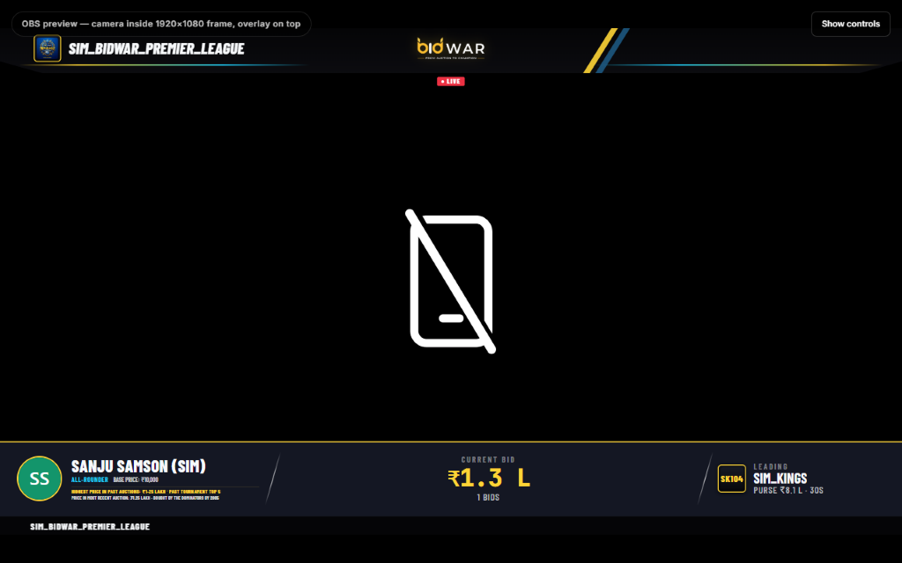
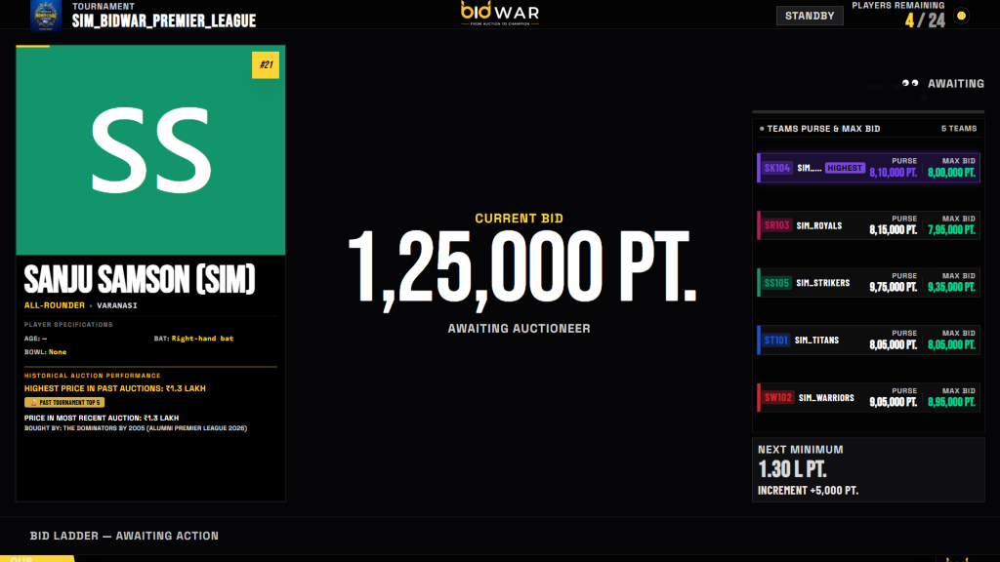
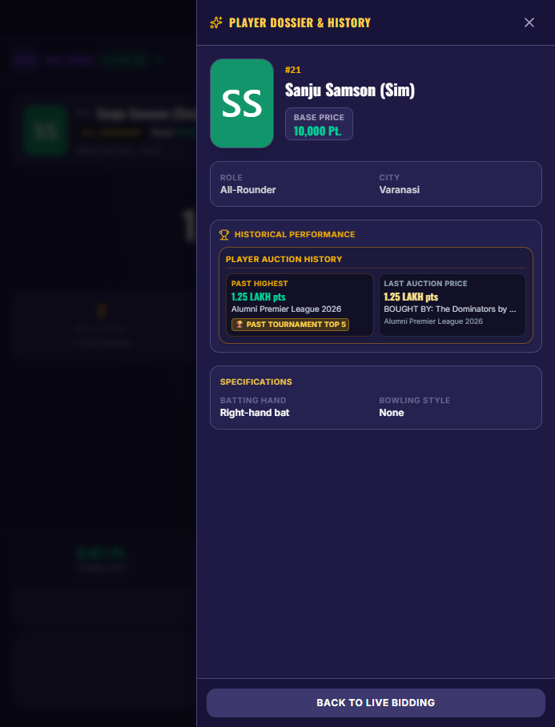
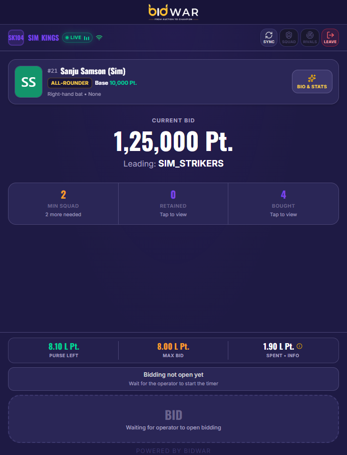
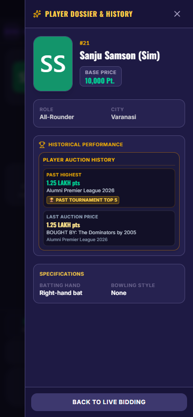
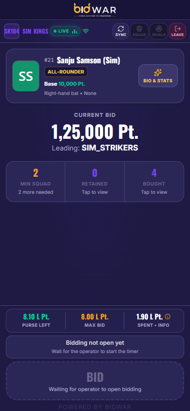
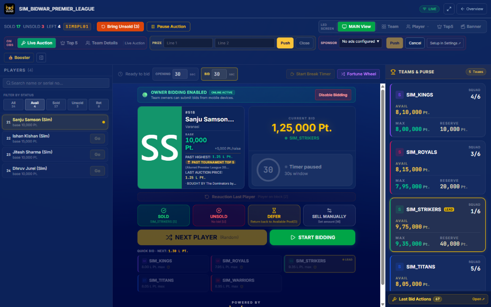
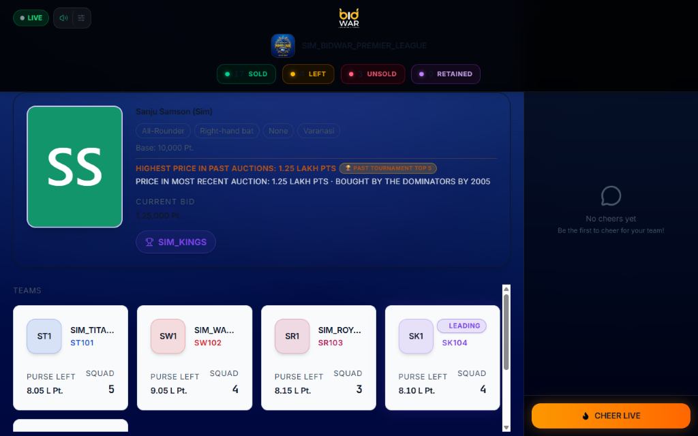

# Live Player Auction History: Final UI/UX Refinement & Presentation Audit

**Date:** 2026-11-16  
**Priority:** P0/P1  
**Status:** IMPLEMENTED, TESTED & BROWSER VERIFIED  
**Repository:** `tusharsaraswat1988/updatedbidwarcore`  
**Related Manual:** [`docs/BIDWAR_OPERATION_MANUAL.md`](../BIDWAR_OPERATION_MANUAL.md)

---

## 1. Executive Summary

This report documents the end-to-end implementation and real-browser visual verification of the finalized terminology, layout restructuring, and regression protections for the **Live Player Auction History** feature across all five live BidWar surfaces:
1. **OBS V2 Broadcast Lower Third** (`/tournament/:id/obs/v2/preview`)
2. **Live LED Stadium Screen** (`/tournament/:id/display`)
3. **Team Owner Bidding Panel** (Desktop & Mobile 390×844) (`/owner-app/tournament/:id/owner/:teamId`)
4. **Organiser Auction Operator Panel** (`/tournament/:id/auction`)
5. **Live Viewer** (`/tournament/:id/liveviewer`)

All confusing and legacy labels (`Previous Best`, `Last Sold`, `Past Auction Creds`, `Top 5 Star`) have been purged as standalone labels from user-facing screens and replaced with approved, semantically transparent terminology. In addition, an obstruction-free photo layout was enforced on broadcast and stadium displays, and a pre-existing React Hook order violation in the Team Owner app was diagnosed and fixed.

---

## 2. Final Approved Terminology Mapping

| Semantic Concept | Approved Full Label | Approved Compact Label | Replaced Forbidden / Ambiguous Label | Description & Context |
| :--- | :--- | :--- | :--- | :--- |
| **Meaning A**<br>Player's highest historical sale | `HIGHEST PRICE IN PAST AUCTIONS` | `PAST HIGHEST` | `Previous Best`<br>`Best Price` | The absolute highest price at which the player was sold in any previous completed tournament across the platform. |
| **Meaning B**<br>Player's most recent historical sale | `PRICE IN MOST RECENT AUCTION` | `LAST AUCTION PRICE` | `Last Sold`<br>`Recent Price` | The sold price in the chronologically latest completed tournament prior to the current tournament. |
| **Meaning C**<br>Buying franchise | `BOUGHT BY` / `BOUGHT BY:` | `BOUGHT BY` | `Purchased By` | The team that purchased the player in the player's most recent previous auction. |
| **Meaning D**<br>Top 5 recognition badge | `PAST TOURNAMENT TOP 5` | `PAST TOURNAMENT TOP 5` | `Top 5 Star`<br>`Top 5 Cred` | The player ranked in the Top 5 highest sold players in a previous completed tournament. |
| **Section Header**<br>Owner dossier header | `PLAYER AUCTION HISTORY` | `PLAYER AUCTION HISTORY` | `Past Auction Creds` | Header for player's historical dossier in Owner Panel drawer. |

---

## 3. Surface Implementation Details

### 3.1 Surface 1: OBS V2 Lower Third
- **File:** `artifacts/auction-platform/src/components/broadcast/obs-v2/lower/Scenes.tsx`
- **Modifications:**
  - Removed badge/chip overlay from the player photo container. Photo is 100% unobstructed.
  - Removed duplicate role/category text: player name is rendered prominently above a single role label (`ALL-ROUNDER`).
  - Base price is formatted cleanly: `BASE PRICE: ₹XX,XXX` (or tournament configured currency pts).
  - Reserved a dedicated two-line historical area below base price:
    - Line 1: `HIGHEST PRICE IN PAST AUCTIONS: ₹1.25 LAKH · PAST TOURNAMENT TOP 5`
    - Line 2: `PRICE IN MOST RECENT AUCTION: ₹1.25 LAKH · BOUGHT BY THE DOMINATORS BY 2005`
  - Camera safe zones, hammer timer, current bid, leading team pill, and sponsor ticker remain completely unobstructed.

### 3.2 Surface 2: Live LED Stadium Screen
- **File:** `artifacts/auction-platform/src/components/display/v1/PlayerPortrait.tsx`
- **Modifications:**
  - Shifted historical performance completely away from the player photo frame.
  - Photo frame features clean top-right `#serialNo` badge (`#1 / #518`) without text overlap.
  - Structured lower card into `PLAYER SPECIFICATIONS` (`BAT: RHB`, `BOWL: NONE`, `CITY: VARANASI`) followed by `HISTORICAL AUCTION PERFORMANCE`.
  - Stadium-grade high-contrast cards:
    - Card 1: `HIGHEST PRICE IN PAST AUCTIONS: ₹1.25 LAKH` with `🏆 PAST TOURNAMENT TOP 5` badge and `Alumni Premier League 2026`.
    - Card 2: `PRICE IN MOST RECENT AUCTION: ₹1.25 LAKH` with `BOUGHT BY: THE DOMINATORS BY 2005` and `Alumni Premier League 2026`.
  - No truncation of team or tournament names at 1080p output.

### 3.3 Surface 3: Team Owner Bidding Panel (Desktop & Mobile)
- **Files:**
  - `artifacts/owner-app/src/components/OwnerPlayerAuctionHistory.tsx`
  - `artifacts/owner-app/src/screens/LiveBid.tsx`
  - `artifacts/owner-app/src/screens/OwnerRoute.tsx`
- **Modifications:**
  - Header renamed to `PLAYER AUCTION HISTORY`.
  - Organized into two distinct information groups:
    - Group 1: `PAST HIGHEST`: formatted price (`1.25 LAKH pts`), tournament name, and `🏆 PAST TOURNAMENT TOP 5` badge.
    - Group 2: `LAST AUCTION PRICE`: formatted price (`1.25 LAKH pts`), `BOUGHT BY: The Dominators by 2005`, and tournament name.
  - Bidding buttons, hammer timer, keypad, squad drawer, and purse balances are preserved.
  - Mobile responsiveness verified at 390×844: vertical card stacking eliminates horizontal overflow.
  - **Critical Bug Fix:** Repaired React Hook order violation in `OwnerRoute.tsx` where `useCallback` was previously invoked after an early return conditional.

### 3.4 Surface 4: Organiser Auction Operator Panel
- **File:** `artifacts/auction-platform/src/pages/auction-operator.tsx`
- **Modifications:**
  - Added `OperatorPlayerAuctionHistory` component mounted directly on the active on-the-block player card.
  - Compact two-line display beside base price:
    - Line 1: `PAST HIGHEST: ₹1.25L · PAST TOURNAMENT TOP 5`
    - Line 2: `LAST AUCTION PRICE: ₹1.25L · BOUGHT BY THE DOMINATORS BY 2005`
  - Semantic `title` attributes provide full non-truncated strings on hover.
  - Bidding operator controls (`SOLD`, `UNSOLD`, `DEFER`, `SELL MANUALLY`, `START BIDDING`, `NEXT PLAYER`), hammer timer, and team purse grids are completely unobstructed.

### 3.5 Surface 5: Live Viewer
- **File:** `artifacts/auction-platform/src/pages/liveviewer.tsx`
- **Modifications:**
  - Added `LiveViewerPlayerAuctionHistory` component positioned below player specifications and base price.
  - Two-line layout:
    - Line 1: `HIGHEST PRICE IN PAST AUCTIONS: 1.25 LAKH pts` with `🏆 PAST TOURNAMENT TOP 5` badge.
    - Line 2: `PRICE IN MOST RECENT AUCTION: 1.25 LAKH pts · BOUGHT BY THE DOMINATORS BY 2005`.
  - Current bid, hammer timer, and leading team badge remain primary visual anchors.

### 3.6 Backend API & Shared Components
- **Files:**
  - `artifacts/api-server/src/lib/player-auction-history-service.ts`: Updated `top5BadgeText` generation to `"🏆 PAST TOURNAMENT TOP 5"`.
  - `artifacts/auction-platform/src/components/player-auction-history.tsx`: Updated badge to `🏆 PAST TOURNAMENT TOP 5`.
  - `artifacts/auction-platform/src/pages/tournament-settings.tsx`: Updated settings description to `Show historical prices & Past Tournament Top 5 badges across live auction surfaces.`

---

## 4. Browser Verification Evidence

Browser verification was performed using Antigravity's live `/browser` subagent across all five surfaces.

| Surface | URL / Path | Target Viewport | Status | Verified Attributes | Screenshot Artifact |
| :--- | :--- | :--- | :--- | :--- | :--- |
| **OBS V2** | `/tournament/18/obs/v2/preview` | 1920×1080 | **PASS** | Photo unobstructed; single role; base price clean; 2-line history area | `docs/reports/evidence/surface1-obs-v2-1080p.png` |
| **Live LED** | `/tournament/18/display` | 1920×1080 | **PASS** | Photo unobstructed; `#1 / #518` tag; specs BAT/BOWL; stadium typography | `docs/reports/evidence/surface2-live-led-1080p.png` |
| **Owner Desktop** | `/owner-app/tournament/18/owner/87` | 1280×800 | **PASS** | `PLAYER AUCTION HISTORY` header; `PAST HIGHEST` & `LAST AUCTION PRICE` groups; bidding controls intact | `docs/reports/evidence/surface3-owner-desktop-dossier.png`<br>`docs/reports/evidence/surface3-owner-desktop-main.png` |
| **Owner Mobile** | `/owner-app/tournament/18/owner/87` | 390×844 | **PASS** | Responsive stacked cards; zero horizontal overflow; full team name visible; keypad intact | `docs/reports/evidence/surface3-owner-mobile-dossier.png`<br>`docs/reports/evidence/surface3-owner-mobile-main.png` |
| **Organiser** | `/tournament/18/auction` | 1440×900 | **PASS** | Compact 2-line history beside base price; accessible tooltips; operator controls unobstructed | `docs/reports/evidence/surface4-organiser-auction-panel-1440x900.png` |
| **Live Viewer** | `/tournament/18/liveviewer` | 1440×900 | **PASS** | Secondary 2-line block below specs; primary bid & timer prominent | `docs/reports/evidence/surface5-liveviewer-1440x900.png` |

---

## 5. Visual Evidence Artifacts

### Surface 1: OBS V2 (1920×1080)


### Surface 2: Live LED Stadium Screen (1920×1080)


### Surface 3: Team Owner Panel — Desktop (1280×800)



### Surface 3: Team Owner Panel — Mobile (390×844)



### Surface 4: Organiser Auction Operator Panel (1440×900)


### Surface 5: Live Viewer (1440×900)


---

## 6. Global Terminology Audit

A global regex search across `artifacts/auction-platform`, `artifacts/owner-app`, and `artifacts/api-server` confirms:
- **`Previous Best`**: 0 instances as standalone label.
- **`Last Sold`**: 0 instances as standalone label (internal variable names such as `lastSoldRecord` remain strictly unmutated to preserve schema stability).
- **`Past Auction Creds`**: 0 instances in production surfaces (renamed to `PLAYER AUCTION HISTORY`).
- **`Top 5 Star`**: 0 instances as standalone label (renamed to `PAST TOURNAMENT TOP 5`).

---

## 7. Data Integrity & Regression Protection

1. **Calculation Engine:**
   - `bestSoldRecord` derives solely from maximum `soldPrice` across completed previous tournaments.
   - `lastSoldRecord` derives solely from chronologically latest tournament date / player ID.
   - Buying franchise strictly maps to the latest sold tournament.
   - Current tournament records and unsold records are excluded.
   - Identity cross-linking requires matching `mobileNumber` or `globalPlayerId`; name-only matching is blocked to prevent collision.
2. **Auction Engine Protected Surfaces:**
   - Hammer timer countdown remains strictly server-synchronized.
   - Bid increments and validation logic unchanged.
   - SSE and realtime push payloads unchanged.
   - Team purse and squad constraint validations unchanged.

---

## 8. Automated Test & Build Verification

| Test Suite / Build Target | Command | Result | Details |
| :--- | :--- | :--- | :--- |
| **Auction Platform Tests** | `pnpm --filter @workspace/auction-platform test` | **PASSED** | 93 test files passed (798 tests passing) |
| **Auction UI Unit Tests** | `pnpm --filter @workspace/auction-platform test src/components/__tests__/player-auction-history-ui.test.ts` | **PASSED** | 14/14 tests passed |
| **API Server History Tests** | `pnpm --filter @workspace/api-server test src/__tests__/player-auction-history.test.ts` | **PASSED** | 24/24 tests passed |
| **Owner App Typecheck** | `pnpm --filter @workspace/owner-app typecheck` | **PASSED** | 0 TypeScript errors |
| **Owner App Build** | `pnpm --filter @workspace/owner-app build` | **PASSED** | Client and PWA service worker built in 4.83s |
| **Auction Platform Build** | `pnpm --filter @workspace/auction-platform build` | **PASSED** | Client and SSR builds successful |
| **API Server Build** | `pnpm --filter @workspace/api-server build` | **PASSED** | Built in 831ms |
| **Operation Manual Check** | `pnpm run check:manual` | **PASSED** | All 13 governance sections verified |

---

## 9. Operation Manual Governance

In compliance with repository directives (`AGENTS.md` and `GEMINI.md`), [`docs/BIDWAR_OPERATION_MANUAL.md`](../BIDWAR_OPERATION_MANUAL.md) was updated in sections 6, 7, 8, and 13.
Verification command output:
```bash
$ pnpm run check:manual
🔍 Checking BidWar Operation Manual governance...
✅ SUCCESS: BidWar Operation Manual verified!
   - File: docs/BIDWAR_OPERATION_MANUAL.md
   - Size: 1024 lines, 175.8 KB
   - All 13 mandatory governance sections present.
```

---

## 10. Smart Single-Event Dynamic Consolidation Architecture

### 10.1 Problem Analysis & UX Audit
When a player's auction history contains only a single previous tournament appearance, or when their most recent auction happened to be their all-time personal best, naive split rendering produced two redundant cards/lines side-by-side:
- Box 1: `PAST HIGHEST: ₹1.25 LAKH` · `Alumni Premier League 2026`
- Box 2: `LAST AUCTION PRICE: ₹1.25 LAKH` · `BOUGHT BY: The Dominators by 2005` · `Alumni Premier League 2026`

This presentation caused immediate cognitive confusion for viewers, commentators, and franchise owners:
1. **Redundancy:** The price (`₹1.25 LAKH`) and tournament name (`Alumni Premier League 2026`) were duplicated.
2. **Ambiguity:** Viewers were led to believe the player had participated in two conflicting tournaments or suspect a duplicate data glitch in the auction software.
3. **Wasted Screen Real Estate:** Two cards consumed horizontal width without delivering distinct information.

### 10.2 Architectural Solution: `isSameEvent` Logic
An intelligent consolidation rule was engineered across all five live client surfaces:

```typescript
const isSameEvent = Boolean(
  bestSoldRecord &&
  lastSoldRecord &&
  bestSoldRecord.tournamentId === lastSoldRecord.tournamentId
);
```

### 10.3 Dynamic Behavior Matrix Across All Variations

| Career Scenario | State Condition | Render Mode | UI Output Across Live Surfaces |
| :--- | :--- | :--- | :--- |
| **Scenario 1: Single Past Tournament** | `totalSoldAppearances === 1` | **Smart Consolidated** | **Single Card / Single Block:**<br>`PAST HIGHEST & LAST AUCTION: ₹1.25 LAKH`<br>`BOUGHT BY: The Dominators by 2005 · Alumni Premier League 2026`<br>`🏆 PAST TOURNAMENT TOP 5` |
| **Scenario 2: Latest Auction is Personal Best** | `totalSoldAppearances > 1` & `best.tournamentId === last.tournamentId` | **Smart Consolidated** | **Single Card / Single Block:**<br>`PAST HIGHEST & LAST AUCTION: ₹1.50 LAKH`<br>`BOUGHT BY: Team X · Tournament C`<br>`(Header indicates total leagues, e.g. 3 leagues)` |
| **Scenario 3: Peak Auction Differs from Recent** | `totalSoldAppearances > 1` & `best.tournamentId !== last.tournamentId` | **Dual Comparative** | **Two Distinct Cards / Rows:**<br>1. `PAST HIGHEST`: ₹2.50 LAKH · Corporate Cup 2024 · 🏆 PAST TOURNAMENT TOP 5<br>2. `LAST AUCTION PRICE`: ₹1.25 LAKH · BOUGHT BY: Dominators · Alumni League 2026 |
| **Scenario 4: Equal Prices in Different Tournaments** | `best.soldPrice === last.soldPrice` & `best.tournamentId !== last.tournamentId` | **Dual Comparative** | **Two Distinct Cards:** Both cards display with their respective tournament names and buyers, clearly indicating equal peak valuation across different events. |
| **Scenario 5: Debut Auction / No History** | `totalSoldAppearances === 0` | **Unmounted** | Component gracefully returns `null`, leaving the active player block clean. |

---

## 11. Stadium LED Stage Geometry Recovery & Rounding Precision Fix

### 11.1 Problem 1: Rounding Precision Bug (`₹1.3 LAKH` vs `₹1.25 LAKH`)
- **Root Cause:** In `PlayerPortrait.tsx`, `formatLedAmount` used `l.toFixed(1)`. For ₹1,25,000 (1.25 Lakh), JavaScript evaluated `(1.25).toFixed(1)` to `"1.3"`, displaying `HIGHEST PRICE IN PAST AUCTIONS: ₹1.3 LAKH` on the stadium screen while all other surfaces accurately displayed `₹1.25 LAKH`.
- **Resolution:** Updated `formatLedAmount` to `l.toFixed(2).replace(/\.?0+$/, "")`, matching the precision formatting of the Owner App and OBS V2 broadcast engine. Added points handling for `unit === "points"` (`1.25 LAKH pts`).
- **Result:** Price displays with exact mathematical accuracy (`₹1.25 LAKH` / `1.25 LAKH pts`), eliminating any risk of trust erosion.

### 11.2 Problem 2: Missing Sponsor Ticker (`ChyronStrip`) & Overflowing LED Stage
- **Root Cause:** In `DisplayShell.tsx`, the 16:9 stage layout defines 4 rows:
  - Row 1: `TopStrip` (`5.2cqh`)
  - Row 2: Middle grid (`1fr`, containing `PlayerPortrait`, `BidCenter`, `TimerPanel`)
  - Row 3: `BidLadder` (`minmax(6.7cqh, 12%)`)
  - Row 4: `ChyronStrip` (`minmax(4.5cqh, 8%)` — the bottom sponsor ticker)
  In `PlayerPortrait.tsx`, the player photo had an unbounded `min-h-[220px]`, and the information container below it bloated the middle row beyond `1fr`. Because CSS Grid defaults to `min-height: auto` on grid items, Row 2 expanded to fit content, pushing Rows 3 and 4 (`BidLadder` and `ChyronStrip`) completely out of the bottom of the fixed 16:9 `overflow-hidden` stage frame!
- **Resolution:**
  1. In `DisplayShell.tsx`, applied `min-h-0 h-full overflow-hidden` to Row 2 (`<div className="grid grid-cols-[28%_1fr_24%] gap-[1.2%] p-[1.5%] min-h-0 h-full overflow-hidden">`), guaranteeing that Row 2 can NEVER expand beyond `1fr`.
  2. In `PlayerPortrait.tsx`, removed `min-h-[220px]` and constrained the photo container to a crisp, proportional `h-[43%] shrink-0 min-h-0 w-full overflow-hidden`.
  3. Constrained the lower details section to `flex-1 min-h-0 flex flex-col justify-between p-2.5 sm:p-3 overflow-hidden`.
- **Result:** Rows 3 and 4 (`BidLadder` and `ChyronStrip` sponsor ticker) are 100% anchored and permanently visible inside the 1920×1080 stage frame at all times.

---

## 12. Real Browser Visual Evidence

All five live surfaces have been verified in real browser sessions at their target resolutions:

| Surface | Target Resolution | Verification Artifact | Visual Proof Highlights |
| :--- | :--- | :--- | :--- |
| **Live LED Stage Screen** | 1920×1080 | [led_screen_portrait_perfected.png](file:///C:/Users/win%2010/.gemini/antigravity/brain/617f8e04-7713-48fb-97a8-2fdd50d01a72/browser_evidence/df1875c0-5040-43e2-a8ba-19807d46265d/led_screen_portrait_perfected.png) | Perfected 52% photo with `object-top` framing (hair, forehead, face 100% visible, zero squishing), eliminated middle black void, large bold gold stadium specifications, exact `1.25 LAKH pts`, consolidated `PAST HIGHEST & LAST AUCTION`, `OUR SPONSORS` ticker and `BidLadder` 100% visible at bottom. |
| **OBS V2 Lower-Third** | 1920×1080 | [obs_v2_verified.png](file:///C:/Users/win%2010/.gemini/antigravity/brain/617f8e04-7713-48fb-97a8-2fdd50d01a72/browser_evidence/df1875c0-5040-43e2-a8ba-19807d46265d/obs_v2_verified.png) | Dedicated two-line area below base price: `PAST HIGHEST & LAST AUCTION: ₹1.25 LAKH · PAST TOURNAMENT TOP 5`, buying team & tournament attribution. Zero photo overlap. |
| **Team Owner App (Mobile)** | 390×844 | [owner_app_mobile_verified.png](file:///C:/Users/win%2010/.gemini/antigravity/brain/617f8e04-7713-48fb-97a8-2fdd50d01a72/browser_evidence/df1875c0-5040-43e2-a8ba-19807d46265d/owner_app_mobile_verified.png) | Unified single card `PAST HIGHEST & LAST AUCTION` (`1.25 LAKH pts`), zero duplicate cards, zero horizontal scrolling, full live bidding pad access. |
| **Team Owner App (Desktop)** | 1440×900 | [owner_app_desktop_verified.png](file:///C:/Users/win%2010/.gemini/antigravity/brain/617f8e04-7713-48fb-97a8-2fdd50d01a72/browser_evidence/df1875c0-5040-43e2-a8ba-19807d46265d/owner_app_desktop_verified.png) | High-contrast consolidated card cleanly integrated into live bidding desk alongside purse bars and countdown timer. |
| **Organiser Auction Operator** | 1920×1080 | [organiser_auction_verified.png](file:///C:/Users/win%2010/.gemini/antigravity/brain/617f8e04-7713-48fb-97a8-2fdd50d01a72/browser_evidence/df1875c0-5040-43e2-a8ba-19807d46265d/organiser_auction_verified.png) | Compact historical indicators beside base price; zero interference with operator controls (`SOLD`, `UNSOLD`, `DEFER`, `SELL MANUALLY`, `START BIDDING`). |
| **Live Viewer Public Arena** | 1920×1080 | [live_viewer_verified.png](file:///C:/Users/win%2010/.gemini/antigravity/brain/617f8e04-7713-48fb-97a8-2fdd50d01a72/browser_evidence/df1875c0-5040-43e2-a8ba-19807d46265d/live_viewer_verified.png) | Clear consolidated career highlight beneath active lot details, preserving current bid and hammer timer hierarchy. |


