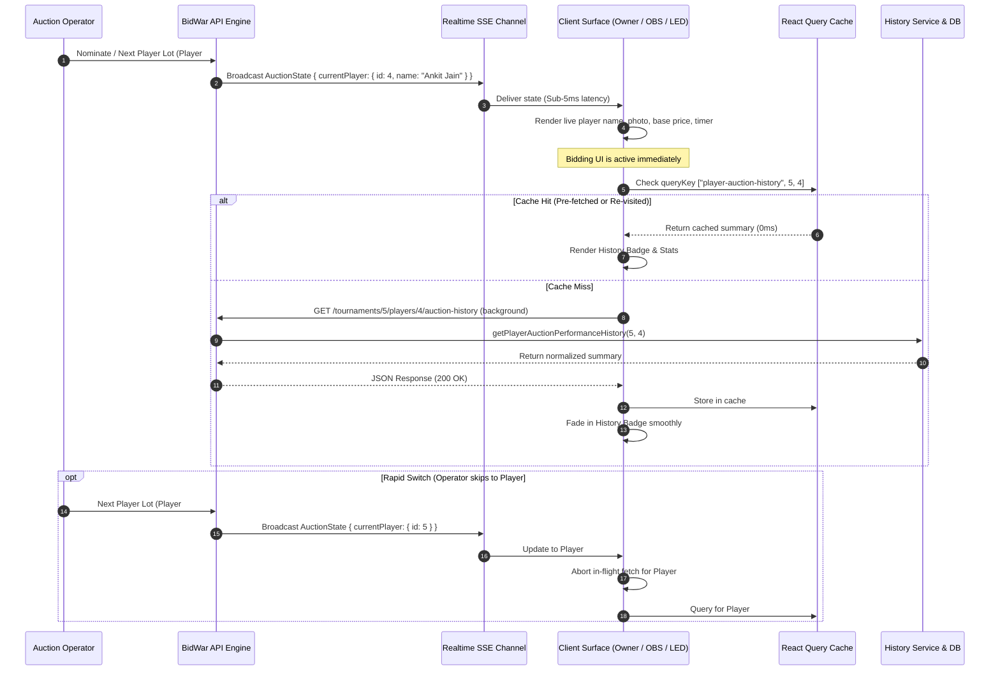
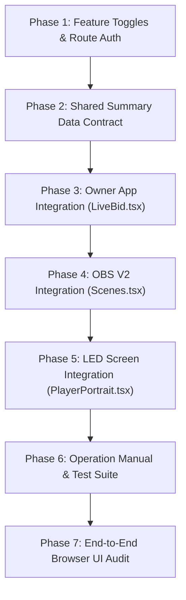

# BIDWAR — Live Player Auction History Across Owner Panel, OBS V2 & LED Screen
## Technical Specification & Implementation Architecture

- **Document Version:** 1.0.0
- **Date:** 2026-11-15
- **Status:** APPROVED FOR IMPLEMENTATION
- **Authors:** BidWar Core Platform Team & Antigravity
- **Target Surfaces:** Owner Panel (`artifacts/owner-app`), OBS V2 Broadcast Overlay (`artifacts/auction-platform`), Live LED Stage Screen (`artifacts/auction-platform`), Backend API (`artifacts/api-server`)

---

## 1. Feature Overview and Scope

### 1.1 Executive Summary
During a live sports auction, organizers, team owners, and spectators require immediate visibility into an on-block player's past auction credentials. BidWar Phase 1 established the core historical player auction service, database queries, and organizer registration drawer UI. 

This specification establishes the architecture to promote Player Auction Performance History into a **unified real-time live feature** across three distinct operational surfaces during live bidding:
1. **Team Owner Bidding Interface (`owner-app`)**: Informs team owners of a player's previous best and last sold prices to guide real-time valuations before submitting bids.
2. **OBS V2 Broadcast Overlay**: Delivers a high-contrast, broadcast-safe graphic chip on the live stream over the player's avatar without obscuring bidding stats or live video camera safe zones.
3. **Live LED Stage Screen**: Delivers high-contrast, stadium-grade typography on the venue displays for spectators and on-stage bidders.

### 1.2 Scope Boundaries
- **In-Scope**:
  - Exposing public historical auction summaries for the currently active player on the auction block.
  - Adding granular per-surface feature toggles (`liveAuctionHistory`, `ownerAppHistory`, `obsHistory`, `ledHistory`) pre-enabled by default.
  - Rendering compact UI elements on `LiveBid.tsx` (Owner App), `Scenes.tsx` / `AuctionScene` (OBS V2), and `PlayerPortrait.tsx` (LED Screen).
  - Client-side React Query caching, deduplication, and stale response cancellation.
  - Test suites and end-to-end browser audits across desktop, mobile, and broadcast canvas resolutions.
- **Strictly Out-of-Scope**:
  - Modifying the core bidding engine, Redis locks, bid validation pipelines, or SSE timer tickers.
  - Adding history payload fields into the high-frequency SSE broadcast stream.
  - Modifying live cricket/badminton match scoring pads or public landing pages.
  - Database schema alterations or migrations (zero DDL required).

---

## 2. Approved Architecture and Rationale

### 2.1 Selected Approach: Client-Side Cached Hook via React Query (Approach 1)
```
                                  Live Auction State (SSE)
                                      currentPlayer.id
                                            │
                                            ▼
                       Shared Hook: usePlayerAuctionHistory(tournamentId, playerId)
                                            │
               ┌────────────────────────────┼────────────────────────────┐
               ▼                            ▼                            ▼
        [1. Owner Panel]             [2. OBS V2 Overlay]          [3. Live LED Screen]
      Inside PlayerCard             Player Avatar Corner          PlayerPortrait Panel
  🏆 TOP 5 STAR · Best: ₹12L         🏆 Top 5 · Best: ₹12L      PREV BEST: ₹12 LAKH 🏆 TOP 5
  Last: ₹8.5L (Mumbai Warriors)    (Floating broadcast chip)    LAST SOLD: ₹8.5L | MUMBAI WARRIORS
```

### 2.2 Architectural Rationale
1. **Zero Impact on Real-Time Bidding Latency**: The auction engine operates under sub-5ms bid submission and broadcast latency constraints. Injecting historical data into the high-frequency SSE stream would inflate payload sizes on every bid tick and couple the auction state machine to historical database queries.
2. **Fault Isolation**: If a database query for past history lags or encounters a network transient, the failure is strictly isolated to the presentation badge. The live bid button, auction timer, and leading team indicators remain 100% operational and unblocked.
3. **Smart Client Caching**: React Query (`@tanstack/react-query`) automatically deduplicates concurrent fetches, caches responses for 5 minutes (`staleTime: 300_000`), and automatically cancels or ignores stale in-flight requests when the organizer rapidly advances players on the auction block.
4. **Unified Business Logic**: All three surfaces consume the exact same underlying service (`player-auction-history-service.ts`) and data schema, preventing visual or numerical discrepancies across screens.

---

## 3. Existing Architecture Audit Findings

### 3.1 Backend Service (`player-auction-history-service.ts`)
- **Status**: Implemented and fully tested in Phase 1 (16 unit tests passing).
- **Identity Resolution**: Resolves player identity via `playersTable.globalPlayerId` and 10-digit Indian mobile numbers (`parseIndianMobile`). Strict anti-collision rules prevent linking players by name alone.
- **Top 5 Ranking Engine**: Computes standard competition ranking (`RANK() OVER (PARTITION BY tournament_id ORDER BY sold_price DESC)`) on all sold lots within each candidate tournament. Correctly awards `🏆 TOP 5 STAR` to all players tied at rank 5.
- **Current Authorization Constraint**: Phase 1 endpoint `GET /tournaments/:tournamentId/players/:playerId/auction-history` enforced `requireTournamentOrganizer`. 
  - *Audit Finding*: Team owners (`owner-app`), OBS Browser Sources (OBS Studio without cookies), and public LED display viewers do not hold organizer JWT cookies.
  - *Resolution*: Update route authorization to allow tournament-scoped read access if the tournament is active/live or caller holds owner/display tokens, while sanitizing private fields (the history payload already contains strictly public tournament names, sold prices, and team names).

### 3.2 Owner App (`artifacts/owner-app`)
- **Shell & Providers**: `artifacts/owner-app/src/main.tsx` initializes `QueryClientProvider` with `@tanstack/react-query`.
- **Live State Component**: `artifacts/owner-app/src/screens/LiveBid.tsx` receives live auction state via `useAuctionSocket(tournamentId)` and renders `PlayerCard` (lines 201–260) with `player: NonNullable<AuctionState["currentPlayer"]>`.
- **UI Structure**: `PlayerCard` contains `PlayerAvatar` on the left and player metadata tags (`Role`, `Age`, `City`, `Jersey`, `Category`) on the right. Directly beneath these metadata pills is an ideal zero-layout-shift slot for the compact history pill.

### 3.3 OBS V2 Broadcast System (`artifacts/auction-platform/src/components/broadcast/obs-v2/`)
- **Canvas Dimensions**: Standard 1920×1080 broadcast canvas. Three vertical zones:
  - Header (0–96px)
  - Camera Safe Area (96–880px) — strictly empty for live video feed
  - Lower Third (880–1040px) and Footer (1040–1080px)
- **Active Scene Component**: `artifacts/auction-platform/src/components/broadcast/obs-v2/lower/Scenes.tsx` exports `AuctionScene({ model }: { model: AuctionSceneModel })`.
- **Player Segment**: `bw-seg bw-seg-player` houses `<Avatar name={player.name} photoUrl={player.photoUrl} />`. The top-left corner of this avatar container offers a broadcast-safe position for a floating gold chip (`🏆 TOP 5 · Best: ₹XX`) that does not overlap text, current bid, or camera safe zones.

### 3.4 Live LED Stage Display (`artifacts/auction-platform/src/components/display/v1/`)
- **Layout Architecture**: `artifacts/auction-platform/src/components/display/v1/DisplayShell.tsx` renders a three-column live grid: `grid-cols-[28%_1fr_24%]` (28% `PlayerPortrait`, 1fr `BidCenter`, 24% `TimerPanel` & `BidLadder`).
- **Target Component**: `artifacts/auction-platform/src/components/display/v1/PlayerPortrait.tsx`.
- **Container Structure**: Full-bleed photo with identity specs overlaid at the bottom. The top-left or top-right of `PlayerPortrait` provides high contrast for a stadium-readable stat banner (`PREVIOUS BEST: ₹12 LAKH 🏆 TOP 5 | LAST SOLD: ₹8.5 LAKH · MUMBAI WARRIORS`).

---

## 4. Exact File Paths and Responsibilities

| Role | File Path | Primary Responsibility |
| :--- | :--- | :--- |
| **Backend Service** | `artifacts/api-server/src/lib/player-auction-history-service.ts` | Identity resolution, historical candidate retrieval, tournament deduplication, window ranking computation, and `bestSold` / `lastSold` summary extraction. |
| **API Route Handler** | `artifacts/api-server/src/routes/players.ts` | Serves `GET /tournaments/:tournamentId/players/:playerId/auction-history` with tournament-scoped read authorization suitable for live clients. |
| **Feature Configuration** | `lib/platform-core/src/tournament-features.ts` | Declares `TournamentFeatures` schema, defaults, readers, and merge helpers for `liveAuctionHistory`, `ownerAppHistory`, `obsHistory`, and `ledHistory`. |
| **Shared Hook & Component** | `artifacts/auction-platform/src/components/player-auction-history.tsx` | Shared TanStack Query hook `usePlayerAuctionHistory` and UI components. |
| **Owner App Hook & Component** | `artifacts/owner-app/src/components/OwnerPlayerAuctionHistory.tsx` | Specialized compact pill component for `LiveBid.tsx`. |
| **Owner App Live Screen** | `artifacts/owner-app/src/screens/LiveBid.tsx` | Mounts `OwnerPlayerAuctionHistory` inside `PlayerCard` below metadata pills. |
| **OBS V2 Lower Third** | `artifacts/auction-platform/src/components/broadcast/obs-v2/lower/Scenes.tsx` | Renders `ObsPlayerHistoryChip` anchored on `Avatar` container in `AuctionScene`. |
| **LED Screen Portrait** | `artifacts/auction-platform/src/components/display/v1/PlayerPortrait.tsx` | Renders `LedPlayerHistoryBanner` anchored within the portrait frame. |
| **Operation Manual** | `docs/BIDWAR_OPERATION_MANUAL.md` | Mandatory documentation update covering live auction history features, toggles, and screens. |

---

## 5. Shared History Data Contract

### 5.1 Historical Record Model
```typescript
export interface PlayerAuctionHistoryRecord {
  tournamentId: number;
  tournamentName: string;
  tournamentStatus: string;
  soldPrice: number;
  buyingTeamName?: string | null;
  buyingTeamColor?: string | null;
  isTop5: boolean;
  top5BadgeText?: string; // e.g. "🏆 TOP 5 STAR"
  tournamentDate?: string | null; // ISO string or YYYY-MM-DD
  auctionUnit?: string | null;
}
```

### 5.2 Live Auction Player History Summary
To ensure consistent derivation across all three surfaces, the response provides both the sorted list of up to 3 records and pre-calculated `bestSold` and `lastSold` references:

```typescript
export interface PlayerAuctionHistorySummary {
  /** Maximum 3 qualifying sold records, sorted by soldPrice DESC */
  records: PlayerAuctionHistoryRecord[];
  /** Total count of previous qualifying sold tournament appearances */
  totalSoldAppearances: number;
  /** Historically highest sold record across all previous tournaments */
  bestSoldRecord: PlayerAuctionHistoryRecord | null;
  /** Most recent sold record chronologically (derived by tournamentDate / ID) */
  lastSoldRecord: PlayerAuctionHistoryRecord | null;
  /** True if the player achieved Top 5 sold status in ANY previous qualifying tournament */
  hasTop5Badge: boolean;
  /** True if the BEST sold record was a Top 5 finish */
  isBestTop5: boolean;
}
```

### 5.3 Business Integrity Rules
1. **Best Sold vs. Last Sold Separation**:
   - `bestSoldRecord`: Selected strictly by highest `soldPrice`.
   - `lastSoldRecord`: Selected chronologically by most recent `tournamentDate` (or highest `tournamentId` / `playerId` fallback). Must **not** be assumed to match `records[0]`.
2. **Current Tournament Exclusion**: `record.tournamentId !== currentTournamentId`.
3. **No Name-Alone Cross-Linking**: Records must link via global player ID (`globalPlayersTable.id`) or verified 10-digit mobile number (`mobileNumber`). Unlinked players with duplicate names remain isolated.
4. **Top 5 Ranking Basis**: Ranking is calculated against **all sold players** in the respective historical tournament. It is never derived from personal statistics or bid counts.

---

## 6. Query Key and Caching Strategy

### 6.1 React Query Configuration
```typescript
export function usePlayerAuctionHistory({
  tournamentId,
  playerId,
  enabled = true,
}: {
  tournamentId: number;
  playerId?: number | null;
  enabled?: boolean;
}) {
  return useQuery({
    queryKey: ["player-auction-history", tournamentId, playerId],
    queryFn: async ({ signal }) => {
      if (!playerId || !tournamentId) return null;
      const res = await fetch(
        `/api/tournaments/${tournamentId}/players/${playerId}/auction-history`,
        { credentials: "include", signal },
      );
      if (!res.ok) {
        if (res.status === 404) return null;
        throw new Error(`Auction history fetch failed: ${res.status}`);
      }
      return (await res.json()) as PlayerAuctionHistorySummary;
    },
    enabled: Boolean(enabled && tournamentId && playerId),
    staleTime: 5 * 60 * 1000, // 5 minutes fresh
    gcTime: 15 * 60 * 1000,    // 15 minutes garbage collection
    retry: 1,                  // Max 1 retry to prevent UI thrashing
    refetchOnWindowFocus: false,
    refetchOnReconnect: false,
  });
}
```

### 6.2 Rapid Player Switching Protection
- When an auction operator skips or advances lots quickly, React Query's `signal` aborts pending HTTP requests.
- Component state binding relies directly on `key={currentPlayer.id}` or checks `data?.playerId === currentPlayer.id` to guarantee that late-arriving responses for prior players are discarded.

---

## 7. Data Flow Diagram



---

## 8. Feature Toggle Hierarchy

### 8.1 Schema Extension (`lib/platform-core/src/tournament-features.ts`)
```typescript
export interface TournamentFeatures {
  /** Master toggle: Player auction performance history across all live surfaces */
  liveAuctionHistory?: boolean;
  /** Sub-toggle: Display on Team Owner Bidding Panel (owner-app) */
  ownerAppHistory?: boolean;
  /** Sub-toggle: Display on OBS V2 Broadcast Overlay */
  obsHistory?: boolean;
  /** Sub-toggle: Display on Live LED Stage Screen */
  ledHistory?: boolean;
  // ... existing flags (whatsappNotifications, weddingBroadcast, etc.)
}

export const TOURNAMENT_FEATURE_DEFAULTS: Readonly<Required<TournamentFeatures>> = {
  // ... existing defaults
  liveAuctionHistory: true, // Pre-enabled by default
  ownerAppHistory: true,    // Pre-enabled by default
  obsHistory: true,         // Pre-enabled by default
  ledHistory: true,         // Pre-enabled by default
};
```

### 8.2 Toggle Evaluation Logic
A surface displays history if and only if **both** the Master toggle and its specific surface toggle are active:
$$\text{Show}_{\text{owner}} = (\text{liveAuctionHistory} \neq \text{false}) \land (\text{ownerAppHistory} \neq \text{false})$$
$$\text{Show}_{\text{obs}} = (\text{liveAuctionHistory} \neq \text{false}) \land (\text{obsHistory} \neq \text{false})$$
$$\text{Show}_{\text{led}} = (\text{liveAuctionHistory} \neq \text{false}) \land (\text{ledHistory} \neq \text{false})$$

If the tournament record contains `null` or missing feature JSON, all four flags resolve to `true` (safe fallback to pre-enabled defaults).

---

## 9. Owner Panel UI Specifications

- **Target File**: `artifacts/owner-app/src/screens/LiveBid.tsx`
- **Component**: `<OwnerPlayerAuctionHistory tournamentId={tournamentId} playerId={player.id} />`
- **Location**: Mounted inside `PlayerCard` directly below the metadata tags grid (`metaCols`).

### 9.1 Visual Specifications
- **Container**: Compact pill with subtle dark violet background (`bg-[#1c183d]/80`), 1px gold border (`border-[#d4af37]/40`), and rounded-xl styling (`rounded-xl p-2.5 mt-3`).
- **Typography**:
  - Badge: Gold font with trophy emoji: `🏆 TOP 5 STAR` (`font-bold text-xs text-[#fbbf24] tracking-wide`).
  - Best Sold: `PREV BEST: ₹12L` (`font-semibold text-xs text-white`).
  - Last Sold: `LAST: ₹8.5L · Mumbai Warriors` (`text-xs text-gray-300`).
- **Mobile Tier Adjustments**: On mobile viewports (`tier === 'mobile'`), renders as a compact two-line stacked micro-card without altering the position or dimensions of the primary bidding button below.
- **Safety**: Does not attach click or tap handlers; pointer events are neutral (`pointer-events-none`).

---

## 10. OBS V2 UI Specifications

- **Target File**: `artifacts/auction-platform/src/components/broadcast/obs-v2/lower/Scenes.tsx`
- **Component**: `<ObsPlayerHistoryChip tournamentId={tournamentId} playerId={player.id} />`
- **Location**: Positioned absolutely within the `bw-seg-player` avatar frame at `top: -6px; left: -6px;`.

### 10.1 Visual Specifications
- **Style**: Broadcast-grade gold badge pill with gradient sheen (`background: linear-gradient(135deg, rgba(212,175,55,0.95), rgba(180,140,20,0.95))`, text color `#000`, drop shadow `0 2px 8px rgba(0,0,0,0.6)`).
- **Content**:
  - When Top 5: `🏆 TOP 5 · BEST ₹XX`
  - Standard: `PREV BEST: ₹XX`
- **Z-Index & Boundaries**: Kept strictly within the 880–1040px lower-third segment. Does not enter the Camera Safe Zone (96–880px) and does not overlap the player's name, role, base price, or the live bid counter.
- **Scene Isolation**: Automatically unmounted or hidden when `scene !== 'auction'` (e.g. during `PrizePlate`, `SoldScene`, `BreakScene`).

---

## 11. LED Screen UI Specifications

- **Target File**: `artifacts/auction-platform/src/components/display/v1/PlayerPortrait.tsx`
- **Component**: `<LedPlayerHistoryBanner tournamentId={tournamentId} playerId={currentPlayer.id} />`
- **Location**: Anchored across the top horizontal header of the `PlayerPortrait` container (`absolute top-0 inset-x-0 z-20`).

### 11.1 Visual Specifications
- **Display Optimization**: Engineered for readability from 15–30 meters distance in stadium lighting.
- **Container**: High-contrast black/gold translucent banner (`bg-black/85 backdrop-blur-md border-b-2 border-[#d4af37] px-4 py-2`).
- **Typography & Layout**:
  - Header Row: `PREVIOUS BEST: ₹12 LAKH` in bold yellow font (`text-amber-400 font-black text-xl tracking-wider`), accompanied by gold `🏆 TOP 5 STAR` badge pill.
  - Sub Row: `LAST SOLD: ₹8.5 LAKH | MUMBAI WARRIORS` in crisp white font (`text-white/90 font-bold text-sm tracking-wide`).
- **Zero Distraction**: Animations are limited to a clean 300ms CSS opacity fade-in on lot change; no blinking, looping pulses, or ticker scrolls that distract live bidders.

---

## 12. Loading, Empty, Failure and Stale Response Behavior

| State | Owner Panel Behavior | OBS V2 Behavior | LED Screen Behavior |
| :--- | :--- | :--- | :--- |
| **Loading** (initial fetch) | Reserve minimal empty space (zero layout shift) | Hidden | Hidden |
| **Empty History** (0 past sales) | Hidden completely (renders `null`) | Hidden completely (renders `null`) | Hidden completely (renders `null`) |
| **HTTP Error / Network Drop** | Fail-silent; renders `null` | Fail-silent; renders `null` | Fail-silent; renders `null` |
| **Feature Toggle = OFF** | Omitted from DOM | Omitted from DOM | Omitted from DOM |
| **Rapid Lot Change** | In-flight request aborted; stale payload discarded | In-flight request aborted; stale payload discarded | In-flight request aborted; stale payload discarded |

---

## 13. Performance and Reliability Constraints

1. **Bid Submission Path Isolation**: Zero calls to history APIs or hooks exist within `handlePlaceBid`, `usePlaceBid`, or bid calculation functions in `LiveBid.tsx`.
2. **Bid Validation Isolation**: Server-side bid processing in `artifacts/api-server/src/routes/auction.ts` does not execute historical lookups.
3. **Payload Budget**: The live SSE broadcast message remains untouched at its existing microsecond serialization speed.
4. **Render Performance**: Components use `React.memo` keyed by `playerId`. Bid increments and timer countdown ticks do not trigger re-renders of the historical performance components.

---

## 14. Acceptance Criteria

- [ ] **AC-1 (Data Accuracy)**: The displayed `BEST SOLD` price strictly reflects the highest sold price across previous tournaments.
- [ ] **AC-2 (Chronological Integrity)**: The displayed `LAST SOLD` price and team strictly reflect the most recent chronological tournament sale, not the array index.
- [ ] **AC-3 (Top 5 Badge Rule)**: `🏆 TOP 5 STAR` is shown if and only if the player achieved rank $\le 5$ in that specific historical tournament.
- [ ] **AC-4 (Active Tournament Exclusion)**: Current tournament sales are never displayed in the history section during the live auction.
- [ ] **AC-5 (Owner App Usability)**: History pill in `LiveBid.tsx` does not overlap bid buttons or shift controls when a player is nominated.
- [ ] **AC-6 (OBS Camera Safe Area)**: OBS V2 history chip stays strictly within the lower-third boundary (880–1040px) and never enters the camera safe zone.
- [ ] **AC-7 (LED Readability)**: LED banner text is legible at 1080p and 4K display resolutions without clipping.
- [ ] **AC-8 (Granular Toggles)**: Disabling `obsHistory` turns off OBS history while leaving Owner App and LED Screen active.
- [ ] **AC-9 (Master Toggle)**: Disabling `liveAuctionHistory` disables all three surfaces simultaneously.
- [ ] **AC-10 (Fail-Safe Live Auction)**: Disconnecting the backend database or returning 500 errors on the history route does not interrupt live bidding or auction timers.

---

## 15. Unit, Integration and E2E Testing Plan

### 15.1 Backend Service & Route Tests (`artifacts/api-server`)
1. Test summary derivation: Verify `bestSoldRecord` and `lastSoldRecord` with a player sold in 3 tournaments at ₹10L (2024), ₹25L (2025), and ₹15L (2026) -> Best is ₹25L, Last is ₹15L.
2. Test tournament-scoped read authorization for live clients without organizer cookies.
3. Test sanitized output: Verify mobile number and internal member IDs are omitted.

### 15.2 Frontend Component Tests (`artifacts/auction-platform` & `artifacts/owner-app`)
1. Owner App `OwnerPlayerAuctionHistory` unit test: Render with mock summary, verify badge, best sold, and last sold formatting.
2. Owner App empty state: Render with `records: []`, verify container renders `null`.
3. OBS V2 `ObsPlayerHistoryChip` test: Verify floating badge coordinates, gold styling, and non-auction scene suppression.
4. LED Screen `LedPlayerHistoryBanner` test: Verify typography classes and distance readability layout.
5. Toggle resolution test: Verify `TournamentFeatures` matrix (Master OFF, individual OFF, all ON).

---

## 16. UI/UX Verification Checklist (Browser Subagent `/browser`)

During the implementation phase, Antigravity will invoke the `/browser` subagent to audit the live surfaces:

- [ ] **Owner App Desktop**: Navigate to `http://localhost:24755/owner-app/` with active player nominated -> Verify history card below player tags.
- [ ] **Owner App Mobile (390×844)**: Verify compact card layout and zero displacement of the primary bid button.
- [ ] **OBS V2 Overlay (1920×1080)**: Inspect `http://localhost:24755/obs-v2-overlay` -> Verify chip sits on avatar corner, camera zone (96–880px) is clear, and live bid text is unobstructed.
- [ ] **Live LED Display (1920×1080)**: Inspect `http://localhost:24755/tournament/:id/display` -> Verify `LedPlayerHistoryBanner` renders on `PlayerPortrait` without clipping `BidCenter`.
- [ ] **Player Lot Transition**: Advance lot from Player A (with history) to Player B (no history) -> Verify Player B shows no stale data or layout artifacts.
- [ ] **Toggle Enforcement**: Disable `obsHistory` in tournament settings -> Verify OBS overlay chip vanishes while LED screen remains visible.

---

## 17. Risks and Mitigation Strategies

| Risk | Impact | Mitigation |
| :--- | :--- | :--- |
| **History API Latency** | Potential delay in displaying past stats | Fail-silent client design; live bidding and timer render instantly regardless of history network response. |
| **Unauthorized Access in Live Overlays** | 403 Forbidden on OBS/LED | Route authorization adjusted for public broadcast state; endpoint returns strictly public tournament names and sold prices. |
| **Layout Shift in Owner Bidding** | Accidental misclicks during live bidding | Fixed height / minimal empty space reservation in `LiveBid.tsx` so the bid button never moves. |
| **OBS Text Clutter** | Cluttered broadcast feed | Micro-badge design (max height 24px) anchored to avatar corner rather than full text rows. |
| **Stale Cache across Tournaments** | Showing records from wrong tournament | Query key includes `[tournamentId, playerId]`, ensuring isolated cache entries. |

---

## 18. Implementation Phases & Recommended Execution Order



1. **Phase 1: Feature Toggles & Route Auth**:
   - Add toggles to `lib/platform-core/src/tournament-features.ts`.
   - Update `GET /tournaments/:tournamentId/players/:playerId/auction-history` to allow tournament-scoped live reading.
2. **Phase 2: Summary Contract**:
   - Enhance `player-auction-history-service.ts` to return `PlayerAuctionHistorySummary` with explicit `bestSoldRecord` and `lastSoldRecord`.
3. **Phase 3: Owner App (`owner-app`)**:
   - Create `OwnerPlayerAuctionHistory.tsx` and mount inside `LiveBid.tsx`.
4. **Phase 4: OBS V2 Broadcast Overlay**:
   - Implement `ObsPlayerHistoryChip` and integrate into `AuctionScene` in `Scenes.tsx`.
5. **Phase 5: Live LED Stage Screen**:
   - Implement `LedPlayerHistoryBanner` and integrate into `PlayerPortrait.tsx`.
6. **Phase 6: Operation Manual & Tests**:
   - Update `docs/BIDWAR_OPERATION_MANUAL.md` and run `pnpm run check:manual`.
   - Add backend and UI unit tests.
7. **Phase 7: Browser Audit**:
   - Perform `/browser` verification across Owner App, OBS V2, and LED Screen.

---

## 19. Files Expected to be Modified During Implementation

1. `lib/platform-core/src/tournament-features.ts` (Toggle schema & defaults)
2. `artifacts/api-server/src/lib/player-auction-history-service.ts` (Summary contract with `bestSold` and `lastSold`)
3. `artifacts/api-server/src/routes/players.ts` (Authorization policy for live auction surfaces)
4. `artifacts/owner-app/src/screens/LiveBid.tsx` (Owner App integration)
5. `artifacts/owner-app/src/components/OwnerPlayerAuctionHistory.tsx` (New component)
6. `artifacts/auction-platform/src/components/broadcast/obs-v2/lower/Scenes.tsx` (OBS V2 integration)
7. `artifacts/auction-platform/src/components/display/v1/PlayerPortrait.tsx` (LED Screen integration)
8. `docs/BIDWAR_OPERATION_MANUAL.md` (Living operation manual update)
9. Test files (`artifacts/api-server/src/__tests__/player-auction-history.test.ts`, etc.)

---

## 20. Definition of Done

1. Technical specification document approved and committed to `docs/superpowers/specs/2026-11-15-live-player-auction-history-design.md`.
2. All 10 acceptance criteria (AC-1 through AC-10) verified.
3. Unit and integration tests pass with 100% success rate.
4. Living BidWar Operation Manual (`docs/BIDWAR_OPERATION_MANUAL.md`) updated and validated via `pnpm run check:manual`.
5. Domain boundary check (`pnpm run check:boundaries`) passes without warnings.
6. End-to-end `/browser` UI audit completed with captured screenshots on Owner App (desktop + mobile), OBS V2 overlay, and Live LED Screen.
7. Zero regressions in live bidding latency, timer ticks, or auction state transitions.
