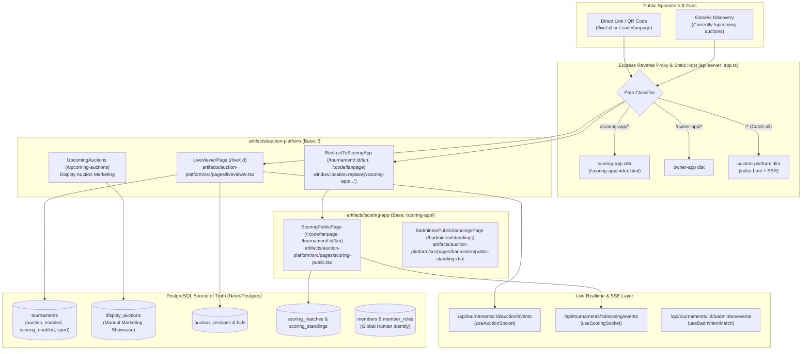

# PHASE 0 — COMPLETE ARCHITECTURE AUDIT: BIDWAR UNIFIED FAN PAGE & DISCOVERY SYSTEM

> **Document Type:** Architectural Audit & Baseline Contract  
> **Repository:** BidWar Core Platform  
> **Status:** Completed Phase 0 Audit — Pending Formal Gate Approval for Phase 1  
> **Date:** November 2026  
> **Canonical Target:** `docs/unified-fan-page/PHASE-0-AUDIT.md`  

---

## EXECUTIVE SUMMARY

BidWar currently provides separate, disconnected public spectator surfaces across two frontend artifacts:
1. **Auction Live Viewer (`artifacts/auction-platform`):** Real-time player bidding cockpit with Web Audio chimes, SSE event streams, interactive cheer reactions, team purse trackers, and sponsor ribbons at `/live/:id` and `/tournament/:id/liveviewer`.
2. **Sports Scoring Fan Page (`artifacts/scoring-app`):** Match centers, live mini-scoreboards, tournament brackets, standings tables, statistics leaderboards, and sponsor showcases at `/scoring-app/tournament/:id/fan` and `/scoring-app/:code/fanpage`.
3. **Badminton Scoring Public View (`artifacts/auction-platform` via `@/pages/badminton/public-standings`):** Standings points table at `/badminton/standings?tid=:id`.

When a tournament enables **Both Auction and Scoring**, spectators are forced to use two disjointed URLs with disparate routing prefixes and navigation paradigms. When a tournament is **Auction-only**, opening the scoring fan page displays an error; conversely, when a tournament is **Scoring-only**, opening the auction viewer renders an inactive/empty auction holding screen. Furthermore, BidWar lacks a unified **Universal Fan Home & Tournament Discovery** portal: spectators cannot browse live, upcoming, or featured tournaments without having a direct private link or QR code.

This Phase 0 Audit provides the comprehensive architectural mapping, route inventory, data lifecycle analysis, security boundaries, and migration plan necessary to consolidate these surfaces into one adaptive, production-grade **BidWar Fan Page** and **Universal Fan Home**, adhering strictly to the BidWar Architecture Contract (`.agents/skills/bidwar_architecture_skill/SKILL.md`).

---

## 1. EXISTING ARCHITECTURE DIAGRAM



---

## 2. COMPONENT HIERARCHY & DATA FLOW

### A. Auction Live Viewer (`LiveViewerPage`)
- **Source File:** `artifacts/auction-platform/src/pages/liveviewer.tsx` (2,664 lines)
- **Primary Routes:** `/live/:id`, `/tournament/:id/liveviewer`, `/live?auction=:id` (redirect)
- **Component Decomposition:**
  ```text
  LiveViewerPage (artifacts/auction-platform/src/pages/liveviewer.tsx)
  ├── useSoundEngine (Web Audio synthesis: newPlayer, bid, sold, unsold, cheer)
  ├── useAuctionSocket (SSE: /api/tournaments/:id/auction/events)
  ├── useAuctionConnectionState (feed latency, connected/reconnecting/disconnected)
  ├── useStickyCountdown (timer sync with auction state)
  ├── DisplayConnectionBanner (offline/reconnection toast)
  ├── Viewer Header Bar
  │   ├── BrandLogoImage (BidWar official SVG / dynamic branding)
  │   ├── AuctionCodeBadge (8-char uppercase code e.g. RC732504)
  │   ├── Liveness Beacon ("LIVE AUCTION" / "FEED IDLE" / "RECONNECTING")
  │   ├── Sound Settings Dialog (newPlayer, bid, sold, unsold, cheer toggles)
  │   ├── Share Modal (copy URL + WhatsApp share CTA)
  │   └── Squad Sheet Trigger ("View Teams & Purses")
  ├── Main Player Presentation Deck
  │   ├── Player Photo Hero (Cloudinary cldUrl optimization)
  │   ├── Player Identity & Specification Badges (Age, Role, Batting/Bowling, Base Price)
  │   ├── LiveViewerPlayerAuctionHistory (Past auction highest bid & recent team spend)
  │   ├── OutcomeResultPanel (Hammer Drop "SOLD" / "UNSOLD" animated overlays)
  │   ├── BreakCountdownOverlay (Break timer sync with looping break audio)
  │   └── AuctionStatusOverlay (Pre-auction holding state & pause state)
  ├── Bidding War Deck
  │   ├── Current Leading Bid Display (Large tabular numeric typography)
  │   ├── Leading Team Brand Pill (Team color, logo, owner name)
  │   ├── Bid Increment Progression Ladder
  │   └── Team Purses Carousel / Squad Pills
  ├── TeamSquadSheet (Radix bottom sheet on mobile, modal on desktop)
  │   ├── Team purse remaining, spent, squad size, max bid allowed, reserved purse
  │   └── Roster of acquired players sorted by acquisition price
  ├── Interactive Fan Cheer Deck
  │   ├── Live Cheer Stream (Recent 10 incoming cheers)
  │   ├── Floating Reaction Emojis (framer-motion floating burst animations)
  │   ├── Cheer Live Trigger Pill & Modal (Presets from DEFAULT_CHEER_PRESETS + custom message)
  │   ├── Heat Meter & Fan Battle (Rival team cheer percentages)
  │   └── Cooldown Throttle Engine (Client-side countdown to prevent 429 errors)
  └── Commercial Ribbons
      ├── SponsorCarousel (Top sponsor rotation)
      └── SponsorTicker (Bottom sticky sponsor ticker with 52px mobile clearance)
  ```
- **Data Fetching & State:**
  - `useGetTournament(id)`: Query key `["tournaments", id]`, stale time 15s.
  - `useGetAuctionState(id)`: Query key `["auction_state", id]`, refetchInterval governed by `sseAwareRefetchInterval(connectionStatus, 30000)`.
  - `useGetTeamPurses(id)`: Query key `["team_purses", id]`.
  - `useListPlayers(id)`: Query key `["players", id]`.
  - `useAuctionSocket(id)`: Listens to SSE event types `auction_state`, `bid`, `sold`, `unsold`, `settings_changed`, `cheer_message`.
  - `POST /api/tournaments/:id/cheer`: Dispatches outbound cheers to the backend.

### B. Sports Scoring Fan Page (`ScoringPublicPage`)
- **Source File:** `artifacts/auction-platform/src/pages/scoring-public.tsx` (631 lines)
- **Primary Routes:** `/:code/fanpage`, `/fan/:id`, `/fanpage/:id`, `/tournament/:id/fan`, `/tournament/:id/cricket`
- **Component Decomposition:**
  ```text
  ScoringPublicPage (artifacts/auction-platform/src/pages/scoring-public.tsx)
  ├── CricketFanExperienceShell (Container chrome, dark background #0B101B)
  │   ├── TournamentFanHeader (Header banner, tournament metadata, share modal)
  │   │   ├── BrandWordmark & MiniLogo
  │   │   ├── Full Tournament Banner (mainBannerUrl)
  │   │   ├── Event Metadata (Dates, Venue, City, Stage Label)
  │   │   └── 4 Section Tabs:
  │   │       ├── "live" (Live Match & Scoreline)
  │   │       ├── "matches_stats" (Matches, Standings, Statistics)
  │   │       ├── "sponsors" (Commercial Sponsors Grid)
  │   │       └── "fan_arena" (Stream, Fan Chat & Battle)
  │   ├── Section: "live"
  │   │   ├── LiveMiniScoreboard (Current batter, bowler, overs, runs/wickets)
  │   │   ├── PublicMatchCard (Active and today's cricket match cards)
  │   │   └── Match Result Cards & Awards (Man of the Match)
  │   ├── Section: "matches_stats"
  │   │   ├── View Selector: Table vs Bracket
  │   │   ├── StandingsTable (Group stage points table, NRR, net points)
  │   │   ├── TournamentBracketTree (Visual knockout bracket progression)
  │   │   └── LeaderboardTable (Runs, Wickets, Strike Rate, Economy, Sixes, Fours)
  │   ├── Section: "sponsors"
  │   │   └── PublicSponsorsStrip (Title sponsor, powered-by, associate tiers)
  │   ├── Section: "fan_arena"
  │   │   ├── FanLiveStreamEditor / Stream Embed (YouTube / direct stream URL)
  │   │   ├── FanArenaSection (Cheer feed, team battle heat meter)
  │   │   └── FanCheerFloatingWidget (In-browser simulated cheer widget)
  ```
- **Data Fetching & State:**
  - `GET /api/register/:code/context`: Resolves 8-character code to `{ tournament: { id, name } }`.
  - `getPublicSchedule(id)`: Polling interval 20s if live matches, 60s if not.
  - `getScoringStandings(id)`: Polling interval 30s.
  - `getScoringLeaderboard(id, category, limit)`: Polling interval 30s.
  - `getScoringLive(id)`: Polling interval 8s when live match is active.
  - `getPublicMatchScorecard(id, matchId)`: Polling interval 10s.
  - `useScoringSocket(id)`: SSE `/api/tournaments/:id/scoring/events`.
  - `useFanCheerState`: In-browser localStorage simulated cheer chat (`bidwar_fan_cheers_${id}`).

### C. Badminton Public Standings (`BadmintonPublicStandingsPage`)
- **Source File:** `artifacts/auction-platform/src/pages/badminton/public-standings.tsx` (72 lines)
- **Primary Routes:** `/badminton/standings?tid=:id`
- **Component Decomposition:**
  ```text
  BadmintonPublicStandingsPage
  ├── FullscreenLayout (lovable-theme)
  ├── Header (BadmintonPublicBrandMark + tournament name + subtitle)
  └── MatchPointsSummary (Points tables per category / round + recent match results)
  ```
- **Data Fetching & State:**
  - `useBadmintonBranding(id)`: Branding and display name.
  - `useBadmintonLeaderboardBoards(id)`: Group/league points table.
  - `fetchBadmintonMatches(id)`: List of all tournament matches (stale time 15s).

---

## 3. COMPLETE ROUTE INVENTORY & ARCHITECTURAL DISCONNECTS

### A. Current Routing Inventory

| Route | Artifact / File | Intended Consumer | Current Status & Issues |
|---|---|---|---|
| `/live/:id` | `artifacts/auction-platform`<br>`pages/liveviewer.tsx` | Public Auction Fans | **Active.** Auction Live Viewer. Does not show scoring or link to scoring. |
| `/tournament/:id/liveviewer` | `artifacts/auction-platform`<br>`pages/liveviewer.tsx` | Public Auction Fans | **Active.** Alias for `/live/:id`. |
| `/live?auction=:id` | `artifacts/auction-platform`<br>`platform-app.tsx` | Public Legacy Users | **Active.** Redirects to `/live/:id`. |
| `/:code/fanpage` | `artifacts/scoring-app`<br>`pages/scoring-public.tsx` | Public Cricket Fans | **Redirected via `RedirectToScoringApp`.** Shows Cricket fan page. Fails on Auction-only tournaments. |
| `/fan/:id` | `artifacts/scoring-app`<br>`pages/scoring-public.tsx` | Public Cricket Fans | **Redirected via `RedirectToScoringApp`.** Shows Cricket fan page. Fails on Auction-only tournaments. |
| `/fanpage/:id` | `artifacts/scoring-app`<br>`pages/scoring-public.tsx` | Public Cricket Fans | **Redirected via `RedirectToScoringApp`.** Shows Cricket fan page. |
| `/tournament/:id/fan` | `artifacts/scoring-app`<br>`pages/scoring-public.tsx` | Public Cricket Fans | **Redirected via `RedirectToScoringApp`.** Shows Cricket fan page. |
| `/tournament/:id/cricket` | `artifacts/scoring-app`<br>`pages/scoring-public.tsx` | Public Cricket Fans | **Redirected via `RedirectToScoringApp`.** Shows Cricket fan page. |
| `/tournaments/:id` | `artifacts/auction-platform`<br>`platform-app.tsx` | Public Legacy Users | **Active.** 302 redirects to `/tournament/:id/fan`. |
| `/tournaments/:id/schedule` | `artifacts/auction-platform`<br>`platform-app.tsx` | Public Legacy Users | **Active.** 302 redirects to `/tournament/:id/cricket/matches`. |
| `/tournaments/:id/standings` | `artifacts/auction-platform`<br>`platform-app.tsx` | Public Legacy Users | **Active.** 302 redirects to `/tournament/:id/cricket/standings`. |
| `/tournament/:id/cricket/matches` | `artifacts/scoring-app`<br>`pages/scoring-public-matches.tsx` | Public Cricket Fans | Dedicated public match schedule & results page. |
| `/tournament/:id/cricket/standings` | `artifacts/scoring-app`<br>`pages/scoring-public-standings.tsx` | Public Cricket Fans | Dedicated public standings table. |
| `/tournament/:id/cricket/teams` | `artifacts/scoring-app`<br>`pages/scoring-public-teams.tsx` | Public Cricket Fans | Dedicated public teams list. |
| `/tournament/:id/cricket/players` | `artifacts/scoring-app`<br>`pages/scoring-public-players.tsx` | Public Cricket Fans | Dedicated public players list. |
| `/tournament/:id/cricket/statistics` | `artifacts/scoring-app`<br>`pages/scoring-public-statistics.tsx` | Public Cricket Fans | Dedicated public statistics leaderboard. |
| `/tournament/:id/cricket/sponsors` | `artifacts/scoring-app`<br>`pages/scoring-public-sponsors.tsx` | Public Cricket Fans | Dedicated public sponsors showcase. |
| `/tournament/:id/cricket/match/:matchId` | `artifacts/scoring-app`<br>`pages/scoring-match-public.tsx` | Public Cricket Fans | Detailed ball-by-ball public match scorecard. |
| `/badminton/standings?tid=:id` | `artifacts/auction-platform`<br>`pages/badminton/public-standings.tsx` | Public Badminton Fans | Dedicated badminton points table. Unlinked from `/tournament/:id/fan`. |
| `/upcoming-auctions` | `artifacts/auction-platform`<br>`pages/upcoming-auctions.tsx` | Public Marketing | Displays manual entries from `display_auctions` table. Not dynamic tournament discovery. |

### B. Identified Architectural Conflicts
1. **Disparate Vite Artifacts (`/` vs `/scoring-app/`):**
   When a user clicks a scoring fan link from marketing or WhatsApp, they hit `auction-platform`, which executes `RedirectToScoringApp`, doing a full page reload (`window.location.replace('/scoring-app/...')`). This destroys client React Query cache, resets memory, and increases load time.
2. **Missing Cross-Module Discovery:**
   A spectator viewing `/live/:id` has zero indication that live cricket or badminton matches are underway for the same tournament.
3. **Hardcoded Sport Assumption:**
   `ScoringPublicPage` currently assumes `cricket` only. If a badminton tournament ID is passed to `/tournament/:id/fan`, it calls cricket endpoints (`/api/tournaments/:id/public/schedule`) and fails with an error or empty state.
4. **Independent Cheer Engines:**
   Auction cheer uses SSE + backend persistence (`POST /api/tournaments/:id/cheer`), while scoring cheer uses local state in `localStorage` without backend broadcast.

---

## 4. API AND LIVE CONNECTION INVENTORY

### A. Backend Public APIs Consumed

| Endpoint | Method | Domain | Purpose | Polling / Frequency |
|---|---|---|---|---|
| `/api/tournaments/:id` | GET | Platform/Tournament | Tournament metadata, sports, module flags | Stale time: 15s |
| `/api/tournaments/:id/auction-state` | GET | Auction | Current live bid, on-the-block player, hammer timer | Polling: 15s - 30s (SSE fallback) |
| `/api/tournaments/:id/team-purses` | GET | Auction | Team purse balances, players bought, max bid | Stale time: 15s |
| `/api/tournaments/:id/players` | GET | Platform/Players | Tournament player roster | Stale time: 60s |
| `/api/tournaments/:id/cheer` | POST | Auction | Post fan cheer reaction | On-demand (throttled by cooldown) |
| `/api/register/:code/context` | GET | Platform/Code Gate | Resolve 8-char tournament code to numeric ID | Cached |
| `/api/tournaments/:id/scoring/public/schedule` | GET | Cricket Scoring | Match schedule, live match status, draws, teams | Polling: 20s (live) / 60s (idle) |
| `/api/tournaments/:id/scoring/standings` | GET | Cricket Scoring | Points table and tournament groups | Polling: 30s |
| `/api/tournaments/:id/scoring/leaderboard` | GET | Cricket Scoring | Top performers (runs, wickets, strike rate) | Polling: 30s |
| `/api/tournaments/:id/scoring/live` | GET | Cricket Scoring | Ball-by-ball live scoreboard snapshot | Polling: 8s (when live match active) |
| `/api/tournaments/:id/scoring/matches/:matchId/scorecard` | GET | Cricket Scoring | Full innings match scorecard | Polling: 10s |
| `/api/tournaments/:id/badminton/matches` | GET | Badminton Scoring | Badminton match list and results | Polling: 15s |
| `/api/tournaments/:id/badminton/standings` | GET | Badminton Scoring | Badminton category points table | Polling: 15s |

### B. Realtime SSE Connection Inventory

| SSE Endpoint | Connection Hook | Triggering Lifecycle | Payload Types |
|---|---|---|---|
| `/api/tournaments/:id/auction/events` | `useAuctionSocket` | Mounted on Auction view when `auctionEnabled !== false` | `auction_state`, `bid`, `sold`, `unsold`, `settings_changed`, `cheer_message` |
| `/api/tournaments/:id/scoring/events` | `useScoringSocket` | Mounted on Cricket Scoring view when live | `scoring_state`, `scoring_replay`, `cricket_obs_director` |
| `/api/tournaments/:id/badminton/events` | `useBadmintonMatch` | Mounted on Badminton view when match active | `badminton_state`, `point_update`, `court_update` |

> [!IMPORTANT]
> **Performance Isolation Principle:** When switching tabs in a tournament that has Both modules enabled, the inactive module MUST NOT maintain an active SSE connection or trigger background query invalidation waterfalls. SSE connections must mount strictly on-demand.

---

## 5. REUSABLE VS. INDEPENDENT DOMAIN COMPONENTS

### A. Reusable Shared Presentation Components
The following components can be extracted into or shared by the Unified Fan Page Shell without touching domain logic:
1. **`TournamentFanHeader` (`artifacts/auction-platform/src/components/scoring/tournament-fan-header.tsx`):**
   - High-fidelity tournament header, brand logos (`useBranding`), tournament banner image, date range, venue, and social share modals (copy link, WhatsApp).
   - Needs extension: Add top-level adaptive module navigation pills (`Auction` vs `Matches & Scoring`).
2. **`DisplayConnectionBanner` (`artifacts/auction-platform/src/components/display/display-connection-banner.tsx`):**
   - Unified offline / reconnection warning toast for SSE drops.
3. **`SponsorCarousel` & `SponsorTicker` (`artifacts/auction-platform/src/components/display/sponsor-ticker.tsx`):**
   - Universal sponsor presentation supporting both auction sponsors and tournament-level sponsors.
4. **`ShareButtons` (`artifacts/auction-platform/src/components/scoring/share-buttons.tsx`):**
   - Public social sharing (WhatsApp, Twitter/X, native navigator share).
5. **Sound Engine (`useSoundEngine` in `liveviewer.tsx`):**
   - Web Audio oscillator chimes for cheer pops, countdown alerts, and boundary events.

### B. Components That MUST Remain Independent
1. **Auction Live Bidding Engine (`LiveViewerPage` body & `OutcomeResultPanel`):**
   - Retains independent auction state, hammer timer, bid tiers, purse calculations, and player reveal animation.
2. **Cricket Scoring Engine (`ScoringPublicPage` sub-views, `LiveMiniScoreboard`, `StandingsTable`):**
   - Retains cricket scoring data contracts (`CricketScoreboardState`, `LeaderboardCategory`, `DLS`).
3. **Badminton Scoring Engine (`MatchPointsSummary`, `useBadmintonLeaderboardBoards`):**
   - Retains badminton sets, points, court tracking, and category draws.
4. **Backend Event Streams:**
   - Auction SSE (`/api/tournaments/:id/auction/events`) and Scoring SSE (`/api/tournaments/:id/scoring/events`) remain completely separate backend endpoints.

---

## 6. UNIVERSAL FAN HOME & TOURNAMENT DISCOVERY AUDIT

### A. Existing Discovery Capability Audit
- **Current State:** There is NO public discovery API or UI for actual tournaments.
- **Current `/upcoming-auctions` Route:**
  - Queries `GET /api/display-auctions`.
  - Backed by `display_auctions` table (created for landing page showcase mocks).
  - Contains manually curated static cards (`toUpcoming` adapter) rather than live tournament data.
- **Current `/api/tournaments` Endpoint:**
  - `GET /api/tournaments` dumps ALL rows from `tournamentsTable` ordered by `createdAt` ascending.
  - Zero pagination (`LIMIT` / `OFFSET` absent).
  - Zero search query support.
  - Zero sport filtering.
  - Zero status filtering (`live`, `upcoming`, `completed`).
  - Serializes everything using `publicTournamentSerializer`.
  - **Risk:** Unbounded database scan that will exhaust Node.js memory as tournament count grows.

### B. Tournament Visibility & Privacy Model Audit
- **Database Schema (`tournamentsTable`):**
  - Currently contains `id`, `name`, `sport`, `auctionCode`, `venue`, `city`, `auctionDate`, `status`, `auctionEnabled`, `scoringEnabled`, `featuresJson`.
  - **Missing Field:** There is no dedicated `visibility` column (`public`, `unlisted`, `private`).
  - Currently, every tournament is returned by `GET /api/tournaments`.
- **Proposed Discovery Privacy Rules:**
  1. **Public:** Discoverable through Fan Home, searchable, visible in categories.
  2. **Unlisted:** Hidden from Fan Home discovery and global search; accessible directly via tournament code or URL (`/tournament/:id/fan` or `/:code/fan`).
  3. **Private:** Requires organizer authentication or scoring PIN; excluded from public discovery.

### C. Proposed Discovery API Contract (`GET /api/fan/tournaments`)
```typescript
// Query Parameters:
// GET /api/fan/tournaments?search=IPL&sport=cricket&status=live&module=both&page=1&limit=20

export type FanTournamentCard = {
  id: number;
  name: string;
  code: string | null;
  sport: string;
  city: string | null;
  venue: string | null;
  organizerName: string | null;
  logoUrl: string | null;
  status: "setup" | "active" | "completed";
  auctionDate: string | null;
  matchDates: string | null;
  auctionEnabled: boolean;
  scoringEnabled: boolean;
  productMode: "auction_only" | "scoring_only" | "both";
  isLive: boolean; // Computed: active auction session OR ongoing live match
  liveSummary?: {
    type: "auction" | "scoring";
    label: string; // e.g. "Lot 14: Virat Kohli · Bid ₹2.4 Cr" or "Team A 142/3 (16.2 ov)"
  } | null;
  featured?: boolean;
};

export type FanDiscoveryResponse = {
  items: FanTournamentCard[];
  pagination: {
    page: number;
    limit: number;
    total: number;
    totalPages: number;
  };
};
```

### D. Fan Following & Favorites Audit
- **Identity Foundation:** `membersTable` already represents canonical human identity (`mem_*`).
- **Role Support:** `memberRolesTable` already defines `role: text("role").notNull()` with `'fan'` as an established role option, scoped to `tournament` via `tournamentId`.
- **Discovery Strategy:**
  - **Phase 1-6 (Zero-Friction Spectator):** Spectators do NOT need to sign in. Store followed/favorite tournament IDs in browser `localStorage` (`bidwar_fan_favorites`, `bidwar_fan_recent`).
  - **Future Mobile/App Phase:** When fan accounts are enabled, sync `localStorage` favorites to `memberRolesTable` (`member_id: mem_*, role: 'fan', scope: 'tournament', tournament_id: :id`).

---

## 7. DATABASE IMPACT ANALYSIS

- **Direct Tournament Consolidation (Phases 1-5):**
  - **Zero Database Schema Changes Required!**
  - Existing columns on `tournamentsTable` (`auction_enabled`, `scoring_enabled`, `sport`, `auction_code`, `status`, `features_json`) provide all required state.
  - Derived product mode is computed dynamically via `resolveTournamentProductMode(tournament)`.
- **Tournament Discovery Optimization (Phase 5/6):**
  - Add optional `visibility` text column to `tournamentsTable` (`public` | `unlisted` | `private`, default `'public'` for legacy tournaments) if persistent organizer control is desired.
  - Add index `ix_tournaments_discovery` on `(status, sport, auction_enabled, scoring_enabled)` to ensure high-performance discovery queries.

---

## 8. RISK REGISTER & MITIGATION STRATEGY

| Risk ID | Category | Description | Severity | Mitigation Strategy |
|---|---|---|---|---|
| **RSK-01** | Routing | Broken share links, QR codes, or bookmarks on legacy URLs (`/live/:id`, `/:code/fanpage`, `/fan/:id`). | **Critical** | Implement backward-compatible alias routes and safe 302 redirects preserving tournament ID and parameters. |
| **RSK-02** | Realtime | Duplicate SSE connections running simultaneously if both Auction and Scoring modules are mounted. | **High** | Strictly unmount the inactive module's EventSource subscription upon tab switch. Ensure query invalidation is tab-scoped. |
| **RSK-03** | Domain | Accidental coupling of Auction bidding logic with Cricket/Badminton scoring rules. | **Critical** | Enforce clear domain boundary: Auction Viewer and Sports Scoring stay as independent child renderers within a shared Shell. |
| **RSK-04** | Performance | Heavy scoring bundles (mission control, image croppers, statistics) loading on Auction-only tournaments. | **High** | Use `lazyWithRetry` route-level code splitting. Scoring renderers are loaded dynamically only when the scoring tab is active. |
| **RSK-05** | UI/UX | Header height explosion or navigation crowding on mobile viewports (360px - 414px). | **Medium** | Build compact, scrollable or segmented module navigation pills inside `TournamentFanHeader`. Audit with `/browser`. |
| **RSK-06** | Audio | Web Audio Context autoplay blocking when switching tabs. | **Medium** | Global `resumeAC` listener on first user touch/click. Preserve sound settings in unified `localStorage` key. |
| **RSK-07** | Discovery | Memory exhaustion from unbounded `SELECT * FROM tournaments` on Fan Home discovery. | **High** | Introduce server-side pagination (`LIMIT 20`), indexed filters, and lightweight card serializer. |
| **RSK-08** | Privacy | Accidentally exposing private or test tournaments on the public Fan Home. | **High** | Exclude unverified/test tournaments and enforce `visibility = 'public'` filter on discovery queries. |

---

## 9. PROPOSED UNIFIED FAN PAGE ARCHITECTURE

### A. Conceptual Architecture

```text
┌────────────────────────────────────────────────────────────────────────┐
│                      BIDWAR UNIFIED FAN SYSTEM                         │
├────────────────────────────────────────────────────────────────────────┤
│                                                                        │
│  [Universal Fan Home]           [Direct Tournament Fan Page]           │
│  Route: /fan                    Route: /tournament/:id/fan             │
│  • Search & Sport Filters       • Unified Tournament Identity          │
│  • Live Now / Upcoming / Past   • Adaptive Module Tab Navigation       │
│  • Favorites (localStorage)     • Shared Brand & Social Share          │
│                                                                        │
│  ┌──────────────────────────────────────────────────────────────────┐  │
│  │                   UNIFIED FAN PAGE SHELL                         │  │
│  │                   (Header, Branding, Tabs, Share)                │  │
│  └──────────────────────────────────┬───────────────────────────────┘  │
│                                     │                                  │
│             ┌───────────────────────┴───────────────────────┐          │
│             ▼                                               ▼          │
│  ┌───────────────────────┐                     ┌────────────────────┐  │
│  │    AUCTION MODULE     │                     │   SCORING MODULE   │  │
│  │  (LiveViewer Renderer)│                     │  (Sport Selector)  │  │
│  │  • Bidding Cockpit    │                     └─────────┬──────────┘  │
│  │  • Team Purses        │                               │             │
│  │  • Auction SSE Stream │                  ┌────────────┴──────────┐  │
│  │  • Cheer Reactions    │                  ▼                       ▼  │
│  └───────────────────────┘          ┌───────────────┐       ┌──────────┤
│                                     │Cricket Fan Pad│       │Badminton │
│                                     │• Scorecard    │       │• Standings│
│                                     │• Standings    │       │• Results │
│                                     │• Leaderboard  │       └──────────┘
│                                     └───────────────┘                  │
└────────────────────────────────────────────────────────────────────────┘
```

### B. Adaptive Navigation Rules
- **Auction-Only (`auction_enabled=true, scoring_enabled=false`):**
  - Renders Auction Live Viewer experience directly.
  - Scoring tab is **hidden**.
- **Scoring-Only (`auction_enabled=false, scoring_enabled=true`):**
  - Renders Sport Scoring experience directly (Cricket or Badminton based on `tournament.sport`).
  - Auction tab is **hidden**.
- **Both Enabled (`auction_enabled=true, scoring_enabled=true`):**
  - Renders top-level module switcher pills: `[⚡ Live Auction]` and `[🏏 Matches & Scoring]`.
  - Intelligently defaults to the active live session (Auction if auction session is live; Scoring if match is live).
  - Manual tab click updates URL parameter (`?tab=auction` or `?tab=scoring`) without page refresh.
  - Switching tabs preserves user state, pauses inactive SSE stream, and resumes active stream.

---

## 10. EXACT FILE PATHS INVOLVED

### A. Existing Files Inspected
- `artifacts/auction-platform/src/App.tsx` (Root router for main platform)
- `artifacts/auction-platform/src/platform-app.tsx` (Platform routes, `/live/:id`, redirects)
- `artifacts/auction-platform/src/pages/liveviewer.tsx` (Auction Live Viewer)
- `artifacts/auction-platform/src/pages/scoring-public.tsx` (Cricket Scoring Public Fan Page)
- `artifacts/auction-platform/src/pages/badminton/public-standings.tsx` (Badminton public standings)
- `artifacts/auction-platform/src/components/scoring/tournament-fan-header.tsx` (Tournament fan header)
- `artifacts/auction-platform/src/components/redirect-to-scoring-app.tsx` (Current legacy redirection bridge)
- `artifacts/scoring-app/src/App.tsx` (Scoring application routes)
- `artifacts/api-server/src/app.ts` (Express server & static file host)
- `artifacts/api-server/src/routes/tournaments.ts` (Tournament CRUD & serializers)
- `artifacts/api-server/src/routes/display-auctions.ts` (Landing page display auctions)
- `lib/platform-core/src/tournament-modules.ts` (Product module flags & resolvers)
- `lib/platform-core/src/tournament-identity.ts` (Normalized event identity)
- `lib/db/src/schema/tournaments.ts` (Database schema for tournaments)

### B. Proposed New / Refactored Files (For Implementation Phases)
- `artifacts/auction-platform/src/pages/unified-fan-page.tsx` (New Unified Fan Page entry point & module switcher)
- `artifacts/auction-platform/src/pages/fan-home.tsx` (New Universal Fan Home discovery portal)
- `artifacts/auction-platform/src/components/fan/unified-module-nav.tsx` (Adaptive module navigation tabs)
- `artifacts/auction-platform/src/components/fan/tournament-discovery-card.tsx` (Discovery tournament card)
- `artifacts/api-server/src/routes/fan-discovery.ts` (New `GET /api/fan/tournaments` discovery API)
- `docs/BIDWAR_OPERATION_MANUAL.md` (Living operation manual updates)

---

## 11. TEST STRATEGY

Every subsequent phase will be verified using:
1. **Domain Boundary Verification:** `pnpm run check:boundaries`
2. **Operation Manual Governance Verification:** `pnpm run check:manual`
3. **Automated Unit & Integration Tests (Vitest):**
   - Module resolution logic (`auction_only`, `scoring_only`, `both`, invalid fallback).
   - Route compatibility & parameter handling.
   - Intelligent default tab selection matrix.
   - Discovery search, sport filtering, and pagination limits.
4. **Browser UI/UX Verification (`/browser`):**
   - Desktop (1440x900), Tablet (768x1024), and Mobile (375x667 / 390x844).
   - Verify zero horizontal overflow, tab switching transitions, sound engine toggle, and cheer reaction overlays.

---

## 12. PROPOSED PHASE-WISE IMPLEMENTATION ROADMAP

- **Phase 0:** Complete Architecture Audit (THIS REPORT — Review & Gate Approval).
- **Phase 1:** Architecture Design & Implementation Contract (`docs/unified-fan-page/PHASE-1-ARCHITECTURE.md`).
- **Phase 2:** Build Unified Fan Page Shell (`unified-fan-page.tsx`, shared header, adaptive module tabs).
- **Phase 3:** Integrate Auction and Scoring Child Renderers (preserve existing bidding & scoring features).
- **Phase 4:** Routes, Deep Links, and Backward Compatibility (canonical URLs + legacy redirect preserves).
- **Phase 5:** Universal Fan Home & Intelligent Module Selection (`fan-home.tsx`, discovery API, live state default).
- **Phase 6:** Complete Regression Matrix, Performance Audit, and `/browser` Verification.
- **Phase 7:** Mobile App Readiness Contract (`PHASE-7-MOBILE-READINESS.md`).

---

## APPROVAL GATE — PHASE 0 COMPLETION

Phase 0 Architecture Audit is complete.  
**No application code has been modified in Phase 0.**  
All 12 audit deliverables and the 11 Universal Fan Home & Tournament Discovery requirements have been analyzed and documented with verified source code evidence.

**Gate Status:** Ready for user review and explicit approval to proceed to **Phase 1 (Architecture Design & Implementation Contract)**.
