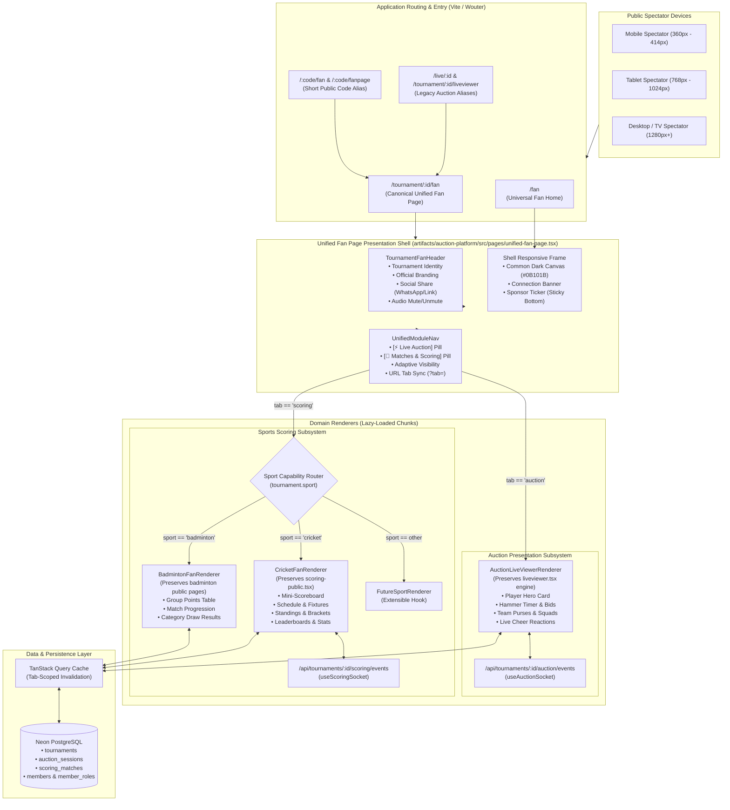
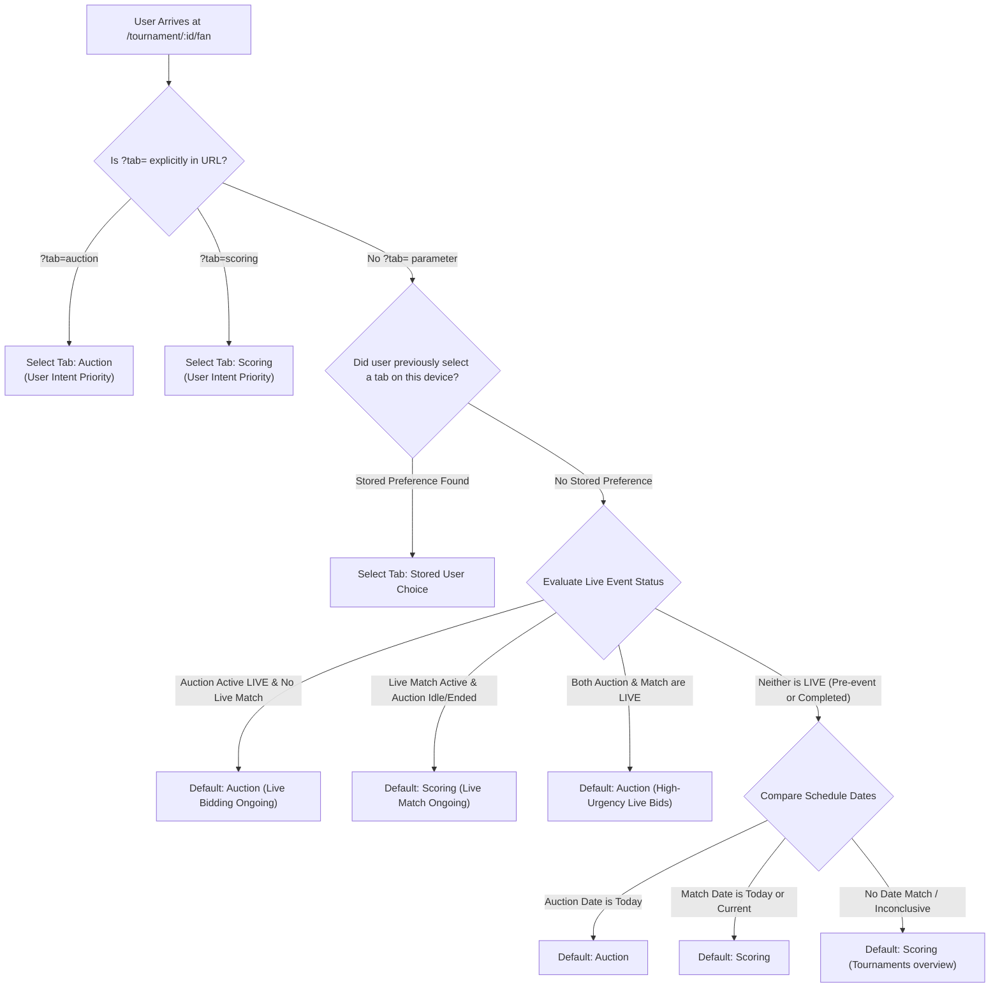

# PHASE 1 — ARCHITECTURE DESIGN: BIDWAR UNIFIED FAN PAGE & UNIVERSAL FAN HOME

> **Document 1 of 9:** System Architecture & Topology Contract  
> **Repository:** BidWar Core Platform  
> **Status:** Architecture Design — Approved for Documentation Only  
> **Canonical Target:** `docs/unified-fan-page/PHASE-1-ARCHITECTURE.md`  

---

## 1. ARCHITECTURAL OBJECTIVE & BOUNDARIES

The BidWar Unified Fan Ecosystem consolidates the currently fragmented public spectator surfaces:
1. **Auction Live Viewer** (`artifacts/auction-platform/src/pages/liveviewer.tsx` at `/live/:id`)
2. **Cricket Scoring Fan Page** (`artifacts/auction-platform/src/pages/scoring-public.tsx` via `artifacts/scoring-app`)
3. **Badminton Public Standings** (`artifacts/auction-platform/src/pages/badminton/public-standings.tsx`)

Into two coherent, production-grade entry points:
- **Direct Tournament Fan Page (`/tournament/:id/fan` & `/:code/fan`):** An adaptive presentation shell that dynamically renders Auction, Cricket Scoring, or Badminton Scoring based on the tournament's enabled modules and configured sport.
- **Universal Fan Home (`/fan`):** A public discovery and search portal allowing spectators to discover live tournaments, upcoming events, and past matches without needing private links.

### Mandatory Domain Boundaries (Engineering Contract)
In accordance with `.agents/skills/bidwar_architecture_skill/SKILL.md`:
1. **Module Independence:** Auction and Sports Scoring are **sibling modules**. Scoring must never depend on Auction, and Auction must never depend on Scoring.
2. **Shared Presentation Layer:** The Unified Fan Page Shell is strictly a **presentation and routing wrapper**. It does not merge domain databases, does not alter scoring engines, and does not alter auction bidding logic.
3. **Performance Isolation:** Inactive modules must never establish realtime subscriptions, start polling timers, or trigger background query invalidations.

---

## 2. HIGH-LEVEL ARCHITECTURE TOPOLOGY



---

## 3. COMPONENT HIERARCHY & REUSE MATRIX

### A. Component Hierarchy Tree

```text
UnifiedFanPage (artifacts/auction-platform/src/pages/unified-fan-page.tsx)
├── ErrorBoundary (fallback: "Tournament Fan Experience")
├── UnifiedFanPageShell (artifacts/auction-platform/src/components/fan/unified-fan-page-shell.tsx)
│   ├── TournamentFanHeader (artifacts/auction-platform/src/components/scoring/tournament-fan-header.tsx - Extended)
│   │   ├── BrandLogoImage & Wordmark (useBranding)
│   │   ├── Tournament Metadata Bar (Name, Dates, Venue, City, Sport badge)
│   │   ├── ShareDialog (Copy URL, WhatsApp direct intent)
│   │   └── SoundControls (Global Web Audio toggle for cheers & match events)
│   ├── UnifiedModuleNav (artifacts/auction-platform/src/components/fan/unified-module-nav.tsx - NEW)
│   │   ├── Mode Pill: "⚡ Live Auction" (Visible when auctionEnabled === true)
│   │   │   └── Live Pulse Beacon (Visible when auction session is active)
│   │   └── Mode Pill: "🏏 Matches & Scores" (Visible when scoringEnabled === true)
│   │       └── Live Match Badge (Visible when match status === 'live')
│   ├── DisplayConnectionBanner (artifacts/auction-platform/src/components/display/display-connection-banner.tsx)
│   │
│   ├── Dynamic Module Host Pane (Suspense fallback: FanModuleSuspenseSkeleton)
│   │   │
│   │   ├── [Active Tab == 'auction']
│   │   │   └── AuctionLiveViewerRenderer (Reuses artifacts/auction-platform/src/pages/liveviewer.tsx)
│   │   │       ├── PlayerPresentationCard (Hero photo, spec badges, status)
│   │   │       ├── LiveViewerPlayerAuctionHistory (Past auction stats)
│   │   │       ├── BiddingWarConsole (Current bid, increment ladder, leader team)
│   │   │       ├── OutcomeResultPanel (Hammer Drop "SOLD" / "UNSOLD" animation)
│   │   │       ├── TeamPursesCarousel & TeamSquadSheet (Purse spent/remaining)
│   │   │       └── CheerInteractiveDeck (Cheer messages, heat meter, float reactions)
│   │   │
│   │   └── [Active Tab == 'scoring']
│   │       └── SportFanRendererHost (artifacts/auction-platform/src/components/fan/sport-fan-renderer-host.tsx - NEW)
│   │           ├── [tournament.sport == 'cricket']
│   │           │   └── CricketFanRenderer (Reuses artifacts/auction-platform/src/pages/scoring-public.tsx)
│   │           │       ├── CricketSubNavTabs (Live, Matches & Stats, Sponsors, Fan Arena)
│   │           │       ├── LiveMiniScoreboard (Ball-by-ball scoreline, batsmen, bowler)
│   │           │       ├── StandingsTable & TournamentBracketTree
│   │           │       ├── LeaderboardTable (Runs, Wickets, SR, Econ)
│   │           │       └── FanArenaSection (Direct stream embed, chat)
│   │           │
│   │           ├── [tournament.sport == 'badminton']
│   │           │   └── BadmintonFanRenderer (Reuses artifacts/auction-platform/src/pages/badminton/public-standings.tsx)
│   │           │       ├── MatchPointsSummary (League tables & category standings)
│   │           │       └── CourtMatchCards (Live and recent court matches)
│   │           │
│   │           └── [tournament.sport == unsupported / future]
│   │               └── GenericSportHoldingRenderer (Holding card + organizer contact)
│   │
│   └── SponsorTicker (artifacts/auction-platform/src/components/display/sponsor-ticker.tsx)
│       └── Sticky bottom commercial ribbon with 52px mobile clearance
```

---

## 4. PRODUCT MODE RESOLUTION ALGORITHM

Product mode must be derived deterministically from the existing `tournamentsTable` columns using `@workspace/platform-core/tournament-modules`:

```typescript
import {
  isAuctionEnabled,
  isScoringEnabled,
  resolveTournamentProductMode,
  type TournamentProductMode,
} from "@workspace/platform-core";

export function resolveFanPageCapabilities(tournament: {
  auctionEnabled?: boolean | null;
  scoringEnabled?: boolean | null;
  sport?: string | null;
}): {
  productMode: TournamentProductMode;
  showAuctionTab: boolean;
  showScoringTab: boolean;
  isScoringSupported: boolean;
} {
  const auction = isAuctionEnabled(tournament);
  const scoring = isScoringEnabled(tournament);
  const sport = (tournament.sport || "").trim().toLowerCase();
  const isScoringSupported = sport === "cricket" || sport === "badminton";

  // Product mode derivation
  let productMode: TournamentProductMode;
  if (auction && scoring) {
    productMode = "both";
  } else if (scoring) {
    productMode = "scoring_only";
  } else if (auction) {
    productMode = "auction_only";
  } else {
    // Legacy fallback: at least one module must be true; defaults to auction_only
    productMode = "auction_only";
  }

  return {
    productMode,
    showAuctionTab: auction,
    // Scoring tab is visible only if scoring is enabled AND sport has an active renderer
    showScoringTab: scoring && isScoringSupported,
    isScoringSupported,
  };
}
```

### Deterministic Truth Table

| `auctionEnabled` | `scoringEnabled` | `sport` | Derived Mode | Auction Tab | Scoring Tab | Default View |
|---|---|---|---|---|---|---|
| `true` | `false` | `cricket` | `auction_only` | Hidden (Direct) | Hidden | Auction View directly |
| `true` | `false` | `badminton` | `auction_only` | Hidden (Direct) | Hidden | Auction View directly |
| `false` | `true` | `cricket` | `scoring_only` | Hidden | Hidden (Direct) | Cricket Scoring directly |
| `false` | `true` | `badminton` | `scoring_only` | Hidden | Hidden (Direct) | Badminton Scoring directly |
| `true` | `true` | `cricket` | `both` | Visible | Visible | Live-State Deterministic (Auction / Scoring) |
| `true` | `true` | `badminton` | `both` | Visible | Visible | Live-State Deterministic (Auction / Scoring) |
| `true` | `true` | `football` | `auction_only`* | Hidden (Direct) | Hidden (Disabled)* | Auction View directly (*Scoring unsupported) |
| `false` | `false` | any | `invalid` | Hidden | Hidden | Safe Empty Holding State ("Tournament Unavailable") |

---

## 5. ADAPTIVE NAVIGATION & DETERMINISTIC DEFAULT-TAB LOGIC

When a tournament enables **Both** modules (`productMode === "both"`), the default tab is selected according to strict precedence rules:



### Critical Interactive Rules:
1. **Manual User Override Lock:** When the user manually taps the `Auction` or `Scoring` pill, the selected tab is immediately written to URL search params (`window.history.replaceState`) and saved in `localStorage`. Background live status changes **MUST NEVER** yank or forcibly switch the user's active tab.
2. **Browser Back/Forward Safety:** URL search parameters (`?tab=auction` and `?tab=scoring`) respond to `popstate` events cleanly without refreshing the shell.

---

## 6. SPORT RENDERER EXTENSIBILITY CONTRACT

Future sports (e.g. Football, Kabaddi, Basketball, Volleyball) must integrate into the Unified Fan Page through a modular registry pattern:

```typescript
export interface SportFanRendererProps {
  tournamentId: number;
  tournament: PublicTournamentMeta;
  streamUrl?: string | null;
  soundEnabled: boolean;
}

export type SportFanRendererComponent = React.ComponentType<SportFanRendererProps>;

export interface SportFanRegistryEntry {
  sportId: string;
  displayName: string;
  renderer: () => Promise<{ default: SportFanRendererComponent }>;
  supportsLiveScores: boolean;
  supportsBrackets: boolean;
}
```

### Registered Renderers:
- **`cricket`:** Lazy loads `@/pages/scoring-public` (ball-by-ball scoreboard, DLS, wagon wheel, player awards, standings, statistics).
- **`badminton`:** Lazy loads `@/pages/badminton/public-standings` & badminton court match component (points table, games won/lost, sets).
- **`future_sport`:** To add a sport, an engineer adds an entry to `sport-fan-registry.ts` without touching `unified-fan-page.tsx` or auction components.

---

## 7. UNIVERSAL FAN HOME & DISCOVERY SYSTEM

The Universal Fan Home (`/fan`) provides discovery for fans, spectators, and scouts:

### A. Layout Structure (`artifacts/auction-platform/src/pages/fan-home.tsx`)
1. **Hero Discovery Strip:** Search input (tournament name, city, organizer) + quick sport filter chips (`All`, `Cricket`, `Badminton`).
2. **Section 1: Live Now:** Cards with pulsing emerald beacons for active live auctions or in-progress cricket/badminton matches.
3. **Section 2: Featured Tournaments:** Major leagues, verified competitions, or tournaments marked featured.
4. **Section 3: Upcoming Today:** Events scheduled for today with countdown timers.
5. **Section 4: Upcoming Tournaments:** Chronological calendar of forthcoming competitions with purse and team count indicators.
6. **Section 5: Recently Completed:** Past tournament archives with winners and champion team tags.
7. **Favorites & Recents Drawer:** Locally saved bookmarked tournaments (`bidwar_fan_favorites`) accessible in 1 click.

### B. Navigation Contract from Fan Home
Every tournament card on Fan Home routes directly to the canonical Unified Fan Page:
- If a card has an active auction, it clicks to: `/tournament/${id}/fan?tab=auction`
- If a card has an active match, it clicks to: `/tournament/${id}/fan?tab=scoring`
- Default click: `/tournament/${id}/fan`

---

## 8. SUMMARY MATRIX OF CORE ARCHITECTURE DECISIONS

| Decision ID | Domain | Architecture Decision | Justification |
|---|---|---|---|
| **ADR-01** | Routing | Host Unified Fan Page at `/tournament/:id/fan` inside `artifacts/auction-platform`. | Eliminates full-page reloads caused by switching between artifacts (`/` and `/scoring-app/`). |
| **ADR-02** | URLs | Retain all legacy routes (`/live/:id`, `/:code/fanpage`, `/fan/:id`) as instant transparent aliases or 302 redirects. | Zero broken bookmarks, WhatsApp shares, or printed QR codes. |
| **ADR-03** | State | State tabs via URL query param (`?tab=auction` / `?tab=scoring`). | Enables shareable deep links directly to a specific tournament module while maintaining browser history. |
| **ADR-04** | Realtime | Unmount EventSource connections strictly when a module is inactive. | Prevents duplicate event listeners, memory leaks, and CPU throttling on mobile devices. |
| **ADR-05** | Discovery | Introduce `GET /api/fan/tournaments` with server-side pagination and indexing. | Protects database from memory exhaustion caused by unbounded `SELECT *` in `GET /api/tournaments`. |
| **ADR-06** | Privacy | Enforce `visibility = 'public'` for discovery. Unlisted tournaments accessible strictly via direct link/code. | Prevents private corporate or friend tournaments from leaking onto public spectator feeds. |
| **ADR-07** | Identity | Use frictionless `localStorage` for favorites; prepare future cloud sync with `membersTable` & `memberRolesTable`. | Spectators must never be forced to create an account or sign in to browse tournaments or view matches. |

---

*End of Architecture Design Contract (Document 1 of 9).*
