# PHASE 1 — IMPLEMENTATION CONTRACT: PHASE-BY-PHASE EXECUTION PLAN

> **Document 2 of 9:** Engineering Implementation Master Plan  
> **Repository:** BidWar Core Platform  
> **Status:** Implementation Contract — Approved for Documentation Only  
> **Canonical Target:** `docs/unified-fan-page/PHASE-1-IMPLEMENTATION-CONTRACT.md`  

---

## 1. IMPLEMENTATION PRINCIPLES & GOVERNANCE RULES

1. **Strict Sequential Execution:** Only ONE phase may be executed at a time.
2. **Approval Gate Mandate:** Every phase must stop and wait for explicit user approval before proceeding to the next.
3. **Living Operation Manual Enforcement:** In accordance with repository directives, whenever any screen, button, route, or workflow is added or modified, `docs/BIDWAR_OPERATION_MANUAL.md` **MUST** be updated in the same phase and verified via `pnpm run check:manual`.
4. **Git Tree Cleanliness:** Do not overwrite or discard unrelated unstaged user changes. Verify `git status` before and after each phase.
5. **No Blind Rewrites:** Re-use the existing Auction Live Viewer and Sports Scoring engines as child renderers without rewriting business logic.

---

## 2. DETAILED PHASE SPECIFICATIONS (PHASES 2 THROUGH 7)

```mermaid
flowchart LR
    P1["Phase 1\nArchitecture Design\n(Current)"] -->|User Approval| P2["Phase 2\nUnified Fan Shell\n(Header & Tabs)"]
    P2 -->|User Approval| P3["Phase 3\nRenderer Integration\n(Auction & Sports)"]
    P3 -->|User Approval| P4["Phase 4\nRoutes & Aliases\n(Compatibility)"]
    P4 -->|User Approval| P5["Phase 5\nUniversal Fan Home\n(Discovery API)"]
    P5 -->|User Approval| P6["Phase 6\nRegression & Perf\n(/browser Audit)"]
    P6 -->|User Approval| P7["Phase 7\nMobile App Contract\n(Readiness)"]
```

---

### PHASE 2 — BUILD THE UNIFIED FAN PAGE SHELL

#### A. Objective
Create the shared presentation shell, adaptive module navigation tabs, and tournament identity resolution layer inside `artifacts/auction-platform` without modifying internal auction or scoring business logic.

#### B. Scope of Work
- Create `artifacts/auction-platform/src/pages/unified-fan-page.tsx`.
- Create `artifacts/auction-platform/src/components/fan/unified-module-nav.tsx` (adaptive module pills).
- Create `artifacts/auction-platform/src/components/fan/unified-fan-page-shell.tsx` (responsive layout, shared branding, and error/loading states).
- Register route `/tournament/:id/fan` in `artifacts/auction-platform/src/platform-app.tsx`.
- Integrate `resolveFanPageCapabilities` from `@workspace/platform-core`.

#### C. Expected Files to Change
- `artifacts/auction-platform/src/pages/unified-fan-page.tsx` (NEW)
- `artifacts/auction-platform/src/components/fan/unified-module-nav.tsx` (NEW)
- `artifacts/auction-platform/src/components/fan/unified-fan-page-shell.tsx` (NEW)
- `artifacts/auction-platform/src/platform-app.tsx` (MODIFIED: add `/tournament/:id/fan` route)
- `docs/BIDWAR_OPERATION_MANUAL.md` (MODIFIED: document Unified Fan Page Shell)

#### D. Dependencies
- Phase 1 Architecture Approval.
- `@workspace/platform-core/tournament-modules` (existing).
- `@workspace/platform-core/tournament-identity` (existing).

#### E. Acceptance Criteria
1. Opening `/tournament/:id/fan` loads the shell with tournament name, city, venue, and brand logo.
2. For an Auction-only tournament, only the Auction renderer is displayed; Scoring tab is completely hidden.
3. For a Scoring-only tournament, only the Scoring renderer is displayed; Auction tab is completely hidden.
4. For an Auction + Scoring tournament, both `[⚡ Live Auction]` and `[🏏 Matches & Scoring]` navigation pills are rendered.
5. Clicking a tab updates URL query parameter `?tab=` without full-page reloads.
6. Responsive layout verified on desktop, tablet, and mobile viewports.

#### F. Automated Tests
- Unit test suite: `artifacts/auction-platform/src/components/fan/__tests__/unified-module-nav.test.tsx` verifying tab visibility for all module combinations.
- Governance test: `pnpm run check:manual` and `pnpm run check:boundaries`.

#### G. Manual `/browser` Verification
- Desktop (1440x900): Inspect header alignment, navigation tab spacing, and brand logo rendering.
- Mobile (390x844): Verify zero horizontal overflow and touch target sizes (minimum 44x44px).

#### H. Approval Gate
- Stop and present Phase 2 completion report with `/browser` evidence. Await user approval for Phase 3.

---

### PHASE 3 — INTEGRATE AUCTION AND SCORING MODULE RENDERERS

#### A. Objective
Connect the existing Auction Live Viewer (`liveviewer.tsx`) and Sports Scoring public views (`scoring-public.tsx` and badminton standings) into the Unified Fan Page Shell as lazy-loaded domain renderers.

#### B. Scope of Work
- Create `artifacts/auction-platform/src/components/fan/sport-fan-renderer-host.tsx` (dynamic sport capability selector).
- Connect `LiveViewerPage` into the Auction tab, ensuring full preservation of current bid display, hammer timer, team purse drawer, Web Audio sound effects, and live cheer reactions.
- Connect `ScoringPublicPage` into the Scoring tab for cricket tournaments, preserving live mini-scoreboard, standings, bracket trees, leaderboards, and sponsor strips.
- Connect `BadmintonPublicStandingsPage` into the Scoring tab for badminton tournaments.
- Implement strict realtime lifecycle guards: ensure SSE EventSource unmounts when tab switches.

#### C. Expected Files to Change
- `artifacts/auction-platform/src/components/fan/sport-fan-renderer-host.tsx` (NEW)
- `artifacts/auction-platform/src/pages/unified-fan-page.tsx` (MODIFIED: mount domain renderers)
- `artifacts/auction-platform/src/pages/liveviewer.tsx` (MODIFIED: export standalone sub-renderer props if needed)
- `docs/BIDWAR_OPERATION_MANUAL.md` (MODIFIED: document integrated module experiences)

#### D. Dependencies
- Phase 2 Shell completion.
- Auction and Scoring SSE backend endpoints.

#### E. Acceptance Criteria
1. In an Auction + Scoring tournament, switching from Auction to Scoring halts auction SSE and mounts scoring SSE.
2. Switching back to Auction seamlessly reconnects auction SSE without data staleness or error flashes.
3. Audio settings and cheer presets function identically to the existing standalone viewer.
4. Badminton tournaments load the badminton standings renderer; cricket tournaments load the cricket renderer.
5. Unsupported sports show a clean holding card ("Scoring Coming Soon") without crashing.

#### F. Automated Tests
- Integration tests: `artifacts/auction-platform/src/pages/__tests__/unified-fan-page-renderers.test.tsx` verifying clean mount/unmount and event listener cleanup.

#### G. Manual `/browser` Verification
- Test interactive auction bidding simulator and match scoring simultaneously.
- Verify cheer floating emojis and sound synthesis on desktop and mobile.

#### H. Approval Gate
- Stop and present Phase 3 completion report. Await user approval for Phase 4.

---

### PHASE 4 — CANONICAL ROUTES, DEEP LINKS, AND BACKWARD COMPATIBILITY

#### A. Objective
Establish `/tournament/:id/fan` as the canonical destination while preserving 100% backward compatibility for all legacy public URLs, share links, and QR codes.

#### B. Scope of Work
- Update route definitions in `artifacts/auction-platform/src/platform-app.tsx` and `artifacts/api-server/src/app.ts`:
  - `/live/:id` -> transparent alias to Unified Fan Page with default `tab=auction`.
  - `/tournament/:id/liveviewer` -> transparent alias with default `tab=auction`.
  - `/:code/fanpage` -> resolves code and transparently renders Unified Fan Page.
  - `/fan/:id` & `/fanpage/:id` -> transparent alias to Unified Fan Page.
  - `/tournament/:id/cricket` -> transparent alias with default `tab=scoring`.
  - `/tournaments/:id` -> 302 redirect to `/tournament/:id/fan`.
- Update short link generator and share dialogs to generate canonical URLs.

#### C. Expected Files to Change
- `artifacts/auction-platform/src/platform-app.tsx` (MODIFIED)
- `artifacts/auction-platform/src/components/scoring/tournament-fan-header.tsx` (MODIFIED: update canonical share URL)
- `artifacts/auction-platform/src/lib/tournament-navigation.ts` (MODIFIED: generate canonical links)
- `docs/BIDWAR_OPERATION_MANUAL.md` (MODIFIED: document updated URL directory)

#### D. Dependencies
- Phase 3 Renderer Integration.

#### E. Acceptance Criteria
1. Visiting `/live/:id` immediately loads the Unified Fan Page with Auction active without redirect flicker.
2. Visiting `/:code/fanpage` resolves the tournament code and loads the Unified Fan Page directly.
3. Browser Back and Forward buttons navigate cleanly between module tabs.
4. Direct WhatsApp sharing sends the canonical `/tournament/:id/fan` link.

#### F. Automated Tests
- Route regression suite: `artifacts/auction-platform/src/pages/__tests__/unified-fan-routes.test.ts` testing all 12 legacy public URLs.

#### G. Manual `/browser` Verification
- Test opening legacy bookmarks, direct deep links, and shared WhatsApp URL strings in fresh browser sessions.

#### H. Approval Gate
- Stop and present Phase 4 completion report. Await user approval for Phase 5.

---

### PHASE 5 — UNIVERSAL FAN HOME & TOURNAMENT DISCOVERY API

#### A. Objective
Build the public tournament discovery experience: the Universal Fan Home UI (`/fan`) and the high-performance discovery API (`GET /api/fan/tournaments`).

#### B. Scope of Work
- Backend:
  - Create `artifacts/api-server/src/routes/fan-discovery.ts` implementing `GET /api/fan/tournaments`.
  - Add search, sport filtering, module filtering, status filtering (`live`, `upcoming`, `completed`), and server-side pagination (limit 20).
  - Mount route in `artifacts/api-server/src/routes/index.ts`.
- Frontend:
  - Create `artifacts/auction-platform/src/pages/fan-home.tsx`.
  - Create `artifacts/auction-platform/src/components/fan/tournament-discovery-card.tsx`.
  - Implement sections: Hero Search, Live Now, Featured, Upcoming, Completed, and Favorites.
  - Register route `/fan` in `artifacts/auction-platform/src/platform-app.tsx`.

#### C. Expected Files to Change
- `artifacts/api-server/src/routes/fan-discovery.ts` (NEW)
- `artifacts/api-server/src/routes/index.ts` (MODIFIED: mount fan discovery router)
- `artifacts/auction-platform/src/pages/fan-home.tsx` (NEW)
- `artifacts/auction-platform/src/components/fan/tournament-discovery-card.tsx` (NEW)
- `artifacts/auction-platform/src/platform-app.tsx` (MODIFIED: register `/fan`)
- `docs/BIDWAR_OPERATION_MANUAL.md` (MODIFIED: document Universal Fan Home)

#### D. Dependencies
- Phase 4 Canonical Routes.

#### E. Acceptance Criteria
1. Opening `/fan` displays structured sections: Live Now, Featured, Upcoming, and Completed.
2. Search query filters tournaments by name, city, or organizer in real time.
3. Sport filter chips filter tournaments instantaneously.
4. Clicking any tournament card opens that tournament's Fan Page with the correct active module.
5. Inactive/unlisted tournaments do NOT appear in discovery results.
6. Paging or incremental loading operates efficiently without unbounded database scans.

#### F. Automated Tests
- Backend API tests: `artifacts/api-server/src/__tests__/fan-discovery-api.test.ts` testing pagination, search matching, and module filters.
- Frontend tests: `artifacts/auction-platform/src/pages/__tests__/fan-home.test.tsx`.

#### G. Manual `/browser` Verification
- Browse Fan Home on desktop and mobile. Test searching, filtering, bookmarking a tournament, and navigating into a live match.

#### H. Approval Gate
- Stop and present Phase 5 completion report. Await user approval for Phase 6.

---

### PHASE 6 — REGRESSION MATRIX, PERFORMANCE, & BROWSER VERIFICATION

#### A. Objective
Execute a comprehensive functional, visual, and performance regression across all module combinations and sports.

#### B. Scope of Work
- Run complete automated test suite across all packages.
- Measure bundle size, time-to-interactive (TTI), and SSE reconnect latency.
- Conduct deep `/browser` audit across Chrome, mobile emulation, and tablet viewports.
- Update `docs/BIDWAR_OPERATION_MANUAL.md` and run `pnpm run check:manual`.

#### C. Expected Files to Change
- Performance optimizations and bug fixes discovered during testing.
- `docs/BIDWAR_OPERATION_MANUAL.md` (Final manual sign-off).
- `docs/unified-fan-page/PHASE-6-REPORT.md` (NEW).

#### D. Dependencies
- Phases 2 through 5 completed.

#### E. Acceptance Criteria
1. Functional test matrix passes 100% across all 8 tournament combinations (Auction-only, Scoring-only, Both; Live, Upcoming, Completed).
2. Zero console errors or uncaught promise rejections on any fan route.
3. Zero memory leaks on repeated tab switching.
4. `pnpm run check:manual` and `pnpm run check:boundaries` pass cleanly.

#### F. Approval Gate
- Stop and present Phase 6 completion report. Await user approval for Phase 7.

---

### PHASE 7 — MOBILE APP READINESS CONTRACT

#### A. Objective
Document the mobile architecture recommendations and API reuse contract for a future standalone BidWar Fan mobile app (iOS & Android).

#### B. Scope of Work
- Create `docs/unified-fan-page/PHASE-7-MOBILE-READINESS.md`.
- Document reusable API contracts, authentication migration, push notifications, and deep link scheme (`bidwar://tournament/:id/fan`).

#### C. Expected Files to Change
- `docs/unified-fan-page/PHASE-7-MOBILE-READINESS.md` (NEW).

#### D. Approval Gate
- Final project completion and milestone sign-off.

---

*End of Implementation Contract (Document 2 of 9).*
