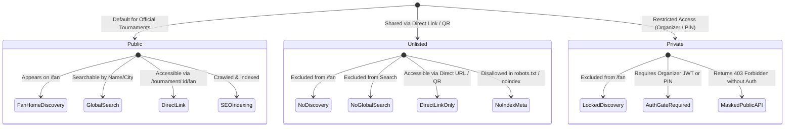

# PHASE 1 — PRIVACY, VISIBILITY & SECURITY CONTRACT

> **Document 5 of 9:** Tournament Visibility & Authorization Boundaries  
> **Repository:** BidWar Core Platform  
> **Status:** Security & Privacy Specification — Approved for Documentation Only  
> **Canonical Target:** `docs/unified-fan-page/PHASE-1-PRIVACY-CONTRACT.md`  

---

## 1. THREE-TIER VISIBILITY MODEL

To protect private corporate leagues, informal community tournaments, and internal test databases from unintended public exposure on the Universal Fan Home, BidWar defines a strict three-tier visibility model:



---

## 2. VISIBILITY & ELIGIBILITY MATRIX

| Feature / Surface | Public Tournament | Unlisted Tournament | Private Tournament |
|---|:---:|:---:|:---:|
| **Universal Fan Home (`/fan`)** | **YES** (Listed in categories) | **NO** (Hidden) | **NO** (Hidden) |
| **Search API (`GET /api/fan/tournaments?search=`)** | **YES** (Searchable) | **NO** (Excluded from query) | **NO** (Excluded from query) |
| **Direct URL (`/tournament/:id/fan`)** | **YES** (Direct access) | **YES** (Direct access) | **NO** (Requires Login/PIN Gate) |
| **Tournament Code (`/:code/fan`)** | **YES** (Direct access) | **YES** (Direct access) | **NO** (Requires Login/PIN Gate) |
| **Search Engine Crawlers (SEO)** | **YES** (`index, follow`) | **NO** (`noindex, nofollow`) | **NO** (`noindex, nofollow`) |
| **Direct Tournament Fan Context API** | **YES** (Public metadata) | **YES** (Public metadata) | **NO** (403 without Auth) |
| **Public Live Scorecard** | **YES** (Public) | **YES** (Public via direct link) | **NO** (Protected) |
| **Public Auction Bidding View** | **YES** (Public) | **YES** (Public via direct link) | **NO** (Protected) |

---

## 3. PERSISTENCE OPTIONS EVALUATION & RECOMMENDATION

During Phase 0, we audited whether an explicit `visibility` column exists on `tournamentsTable`. It does not. We evaluate three architectural alternatives:

### Option A: Add Explicit Column to `tournamentsTable`
- **Schema:** `visibility: text("visibility").notNull().default("public")`
- **Values:** `'public' | 'unlisted' | 'private'`
- **Pros:** Fast indexed SQL queries (`WHERE visibility = 'public'`), clean schema typing.
- **Cons:** Requires a database migration.

### Option B: Store Inside Existing `featuresJson`
- **Schema:** `tournamentsTable.featuresJson -> { "visibility": "public" | "unlisted" | "private" }`
- **Pros:** **Zero database migrations required!** Schema remains completely untouched.
- **Cons:** Querying requires jsonb extraction (`WHERE (features_json->>'visibility') = 'public'`).

### Option C: Hybrid Progressive Approach (RECOMMENDED)
1. **Immediate Implementation (Phase 5):** Use `featuresJson.visibility` (defaults to `'public'` for legacy tournaments, `'unlisted'` for test tournaments).
2. **Indexing:** Use PostgreSQL functional index `CREATE INDEX ix_tournaments_visibility ON tournaments ((features_json->>'visibility'))`.
3. **Future Formal Migration:** If high-volume discovery demands a native column, migrate during an off-peak maintenance window.

---

## 4. PREVENTION OF PRIVATE & INTERNAL DATA LEAKS

### A. Excluded Tournaments from Universal Discovery
The `GET /api/fan/tournaments` query **MUST** enforce the following filter conditions in SQL:
```sql
WHERE
  -- 1. Must have public visibility
  COALESCE(features_json->>'visibility', 'public') = 'public'
  -- 2. Must not be locked by master admin
  AND admin_locked = false
  -- 3. Must have at least one enabled product module
  AND (auction_enabled = true OR scoring_enabled = true)
  -- 4. Exclude internal test / dummy patterns
  AND name NOT ILIKE '%[test]%'
  AND name NOT ILIKE '%demo tournament%'
  AND name NOT ILIKE '%internal test%'
```

### B. Masking of Sensitive Organizer Fields
The discovery and fan context APIs serialize rows using `publicTournamentSerializer`. Under no circumstance may the following fields be exposed on public fan surfaces:
- `organizerMobile`
- `organizerEmail`
- `organizerPassword`
- `scoringPin`
- `exportToken`
- `upiId`

---

## 5. AUTHENTICATION & ACCESS CONTROL ON PRIVATE TOURNAMENTS

If a tournament is set to `visibility = 'private'`:
1. Directly navigating to `/tournament/:id/fan` renders the **BidWar Private Event Gate**.
2. Spectators can enter:
   - **Delegate 4-digit Scorer/Viewer PIN** (`t.scoringPin`), OR
   - **Organizer Authentication** (via signed JWT cookie `bidwar_auth`).
3. Upon entering a valid PIN, an ephemeral HMAC token is written to `sessionStorage` (`bidwar_private_token_${id}`), authorizing queries to `/api/tournaments/:id/fan/context`.

---

*End of Privacy & Security Contract (Document 5 of 9).*
