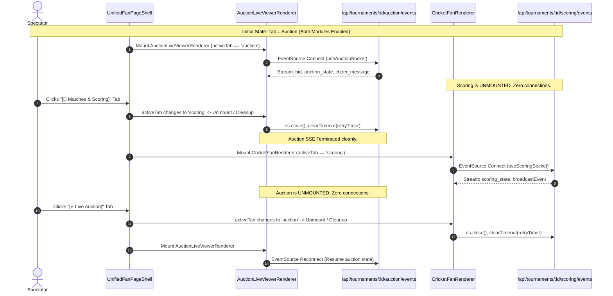

# PHASE 1 — REALTIME SUBSCRIPTION & PERFORMANCE ISOLATION CONTRACT

> **Document 6 of 9:** Realtime SSE Lifecycle & Query Isolation Contract  
> **Repository:** BidWar Core Platform  
> **Status:** Realtime Architecture Specification — Approved for Documentation Only  
> **Canonical Target:** `docs/unified-fan-page/PHASE-1-REALTIME-CONTRACT.md`  

---

## 1. MANDATORY PERFORMANCE ISOLATION PRINCIPLES

BidWar tournaments can be Auction-only, Scoring-only, or Both. In multi-module tournaments, spectators will switch back and forth between the **Live Auction** and **Live Match Scorecards**.

### Non-Negotiable Engineering Rules:
1. **Zero Background Realtime Leakage:** An inactive module **MUST NEVER** maintain an open SSE connection, receive event streams, or trigger React re-renders.
2. **Zero Polling While Hidden:** TanStack Query polling timers (`refetchInterval`) must evaluate `enabled: activeTab === '...' && isVisible`.
3. **Zero Request Waterfalls on Tab Switch:** Switching tabs must immediately reuse cached data and connect to the active stream without fetching unneeded sibling module endpoints.

---

## 2. REALTIME CONNECTION LIFECYCLE & TAB SWITCHING



---

## 3. REALTIME SUBSCRIPTION SPECIFICATIONS

### A. Auction SSE (`useAuctionSocket`)
- **Endpoint:** `/api/tournaments/:id/auction/events`
- **Activation Condition:**
  ```typescript
  const isAuctionActive = activeTab === "auction" && tournament?.auctionEnabled !== false;
  useAuctionSocket(tournamentId, handleCheerMessage, { enabled: isAuctionActive });
  ```
- **Events Handled:**
  - `auction_state`: Updates on-the-block player, hammer timer, bidding status.
  - `bid`: Updates leading bid, leader team, increment amount.
  - `sold` / `unsold`: Triggers hammer drop animation in `OutcomeResultPanel`.
  - `settings_changed`: Invalidates team purses and squad limits.
  - `cheer_message`: Dispatches floating reaction bubbles.
- **Teardown on Unmount:**
  - Invokes `es.close()`.
  - Clears reconnection timeouts (`retryTimer`, `disconnectedTimer`).
  - Removes `visibilitychange` event listener.

### B. Cricket Scoring SSE (`useScoringSocket`)
- **Endpoint:** `/api/tournaments/:id/scoring/events?lastEventId=:seq`
- **Activation Condition:**
  ```typescript
  const isCricketActive = activeTab === "scoring" && tournament?.sport === "cricket" && tournament?.scoringEnabled !== false;
  useScoringSocket(tournamentId, isCricketActive);
  ```
- **Events Handled:**
  - `scoring_state`: Updates ball-by-ball scoreline, overs, current batters, current bowler.
  - `scoring_replay`: Replay ball animation.
  - `cricket_obs_director`: Director overlays and milestone popups.
- **Teardown on Unmount:**
  - Invokes `es.close()`.
  - Clears `retryTimer`.

### C. Badminton Match Realtime (`useBadmintonMatch`)
- **Endpoint:** `/api/tournaments/:id/badminton/events`
- **Activation Condition:**
  ```typescript
  const isBadmintonActive = activeTab === "scoring" && tournament?.sport === "badminton";
  ```
- **Teardown on Unmount:**
  - Invokes shared pool decrement and `closeEventSource`.

---

## 4. POLLING & QUERY ISOLATION MATRIX

When a module is inactive, its background polling must be disabled via TanStack Query's `enabled` and `refetchInterval` options:

| Query Key | Domain | Tab Dependency | Polling Active When | Polling Suspended When |
|---|---|---|---|---|
| `["tournaments", id]` | Shell | Always Active | Every 15s (if active) | Stale time 15s |
| `["auction_state", id]` | Auction | `tab === 'auction'` | Every 15s - 30s | **Immediately upon switching to Scoring** |
| `["team_purses", id]` | Auction | `tab === 'auction'` | On-demand / SSE | **Suspended** |
| `["scoring-public", id]` | Cricket | `tab === 'scoring'` | Every 20s (if live) | **Immediately upon switching to Auction** |
| `["scoring-live", id]` | Cricket | `tab === 'scoring'` | Every 8s (if live) | **Suspended** |
| `["scoring-standings", id]`| Cricket | `tab === 'scoring'` | Every 30s | **Suspended** |
| `["badminton-matches", id]`| Badminton | `tab === 'scoring'` | Every 15s | **Suspended** |

---

## 5. NETWORK DROP & VISIBILITY RECONNECTION LOGIC

### A. Background Tab Throttling (Mobile & Desktop)
When the user minimizes the browser or moves to another tab (`document.visibilityState === 'hidden'`):
1. Both Auction and Scoring SSE listeners pause execution.
2. Polling timers are suppressed by browser background throttling.

### B. Foreground Resumption (`visibilitychange -> 'visible'`)
When the spectator brings the tab back to the foreground:
1. Re-check `activeTab`.
2. Reset event sequence counters (`resetAuctionEventVersion`).
3. Invalidate TanStack Query cache for the **active tab only**.
4. Immediately reconnect the active EventSource stream.
5. Inactive tab remains unmounted and dormant.

---

## 6. CLIENT MEMORY & PERFORMANCE BUDGET

To ensure smooth 60fps animations on budget mobile devices:
- **Maximum Active Connections:** 1 EventSource connection at any time.
- **Maximum DOM Cheer Nodes:** Retain only the latest 10 cheer messages in memory; prune floating reaction emoji nodes after 2,400ms.
- **Bundle Footprint:** Auction components and Scoring components must reside in separate code-split chunks (`lazyWithRetry`), ensuring an initial page bundle size < 180 KB gzipped.

---

*End of Realtime & Performance Contract (Document 6 of 9).*
