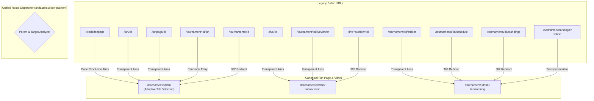

# PHASE 1 — ROUTE MATRIX & URL COMPATIBILITY CONTRACT

> **Document 3 of 9:** Route Architecture, Deep Links & Backward Compatibility  
> **Repository:** BidWar Core Platform  
> **Status:** Route Contract — Approved for Documentation Only  
> **Canonical Target:** `docs/unified-fan-page/PHASE-1-ROUTE-MATRIX.md`  

---

## 1. CANONICAL PUBLIC ROUTES

The BidWar Unified Fan Ecosystem establishes two permanent canonical public URLs:

| Experience | Canonical URL Pattern | Artifact Host | Description |
|---|---|---|---|
| **Universal Fan Home** | `/fan` | `auction-platform` | Public discovery portal, live matches, featured leagues, search & filters. |
| **Direct Tournament Fan Page** | `/tournament/:id/fan` | `auction-platform` | Adaptive event hub rendering Auction, Scoring, or Both depending on enabled modules. |

### Module Deep Links (Canonical Query State)
To link directly to a specific module within a multi-module tournament:
- **Direct to Auction:** `/tournament/:id/fan?tab=auction`
- **Direct to Scoring:** `/tournament/:id/fan?tab=scoring`

---

## 2. LEGACY ROUTE MATRIX & REDIRECTION STRATEGY

Every existing URL that has been shared via WhatsApp, printed on posters, encoded in QR codes, or bookmarked by users must continue working indefinitely.



### Detailed Redirection & Alias Specifications

| Inbound URL | Method / Handling | Target Canonical URL | Preservation Notes |
|---|---|---|---|
| `/tournament/:id/fan` | **Canonical Direct** | `/tournament/:id/fan` | Primary canonical URL for tournament fan experience. |
| `/live/:id` | **Transparent Alias** | Renders Unified Fan Page with default `tab=auction` | Zero redirect hop; instant render for auction viewers. |
| `/tournament/:id/liveviewer` | **Transparent Alias** | Renders Unified Fan Page with default `tab=auction` | Used by internal organizer links and broadcast operators. |
| `/live?auction=:id` | **302 Redirect** | `/tournament/:id/fan?tab=auction` | Legacy Replit query string compatibility. |
| `/:code/fanpage` | **Code Resolver Alias** | Renders Unified Fan Page for resolved tournament ID | Resolves 8-character `auctionCode` (e.g. `RC732504`). |
| `/:code/fan` | **Code Resolver Alias** | Renders Unified Fan Page for resolved tournament ID | Short code share link (e.g. `bidwar.in/IPL26/fan`). |
| `/fan/:id` | **Transparent Alias** | Renders Unified Fan Page for numeric ID | Disambiguated from `/fan` (see Section 3). |
| `/fanpage/:id` | **Transparent Alias** | Renders Unified Fan Page for numeric ID | Legacy link preservation. |
| `/tournament/:id/cricket` | **Transparent Alias** | Renders Unified Fan Page with default `tab=scoring` | Deep link from cricket fixture exports. |
| `/tournaments/:id` | **302 Redirect** | `/tournament/:id/fan` | Fixes common user typo (plural `/tournaments/`). |
| `/tournaments/:id/schedule`| **302 Redirect** | `/tournament/:id/fan?tab=scoring` | Legacy schedule link. |
| `/tournaments/:id/standings`| **302 Redirect** | `/tournament/:id/fan?tab=scoring` | Legacy standings link. |
| `/badminton/standings?tid=:id` | **Transparent Alias** | Renders Unified Fan Page with default `tab=scoring` | Badminton franchise owner share links. |

---

## 3. ROUTE DISAMBIGUATION: `/fan` VS `/fan/:id`

A critical routing collision exists between:
- **Universal Fan Home:** `/fan` (Zero path segments beyond `/fan`)
- **Direct Tournament Fan Page:** `/fan/:id` (One path segment e.g. `/fan/42` or `/fan/RC732504`)

### Resolution Algorithm (Wouter Router)
In `artifacts/auction-platform/src/platform-app.tsx`:

```tsx
<Switch>
  {/* 1. Exact match for Universal Fan Home */}
  <Route path="/fan" component={FanHomePage} />

  {/* 2. Direct legacy tournament links with ID or code */}
  <Route path="/fan/:id">
    {(params) => {
      const raw = params?.id?.trim() ?? "";
      if (!raw || raw === "explore") return <Redirect to="/fan" replace />;
      return <UnifiedFanPage routeIdentifier={raw} />;
    }}
  </Route>

  {/* 3. Canonical direct tournament route */}
  <Route path="/tournament/:id/fan" component={UnifiedFanPage} />
</Switch>
```

---

## 4. CODE RESOLUTION ALGORITHM (8-CHARACTER CODES)

When an inbound route passes an alphanumeric code (e.g. `RC732504` in `/:code/fanpage` or `/fan/:code`):

1. **Check Format:**
   - If string consists purely of digits (`/^\d+$/`), parse as numeric `tournamentId`.
   - If string contains alphabetic characters (e.g. `RC732504`), query code resolution cache.
2. **Resolution Query:**
   - Call existing endpoint: `GET /api/register/:code/context`.
   - Returns `{ tournament: { id: number, name: string } }`.
3. **Cache & Render:**
   - Cache resolution for 24 hours in TanStack Query.
   - Mount Unified Fan Page with resolved `tournament.id`.
4. **Invalid Code Handling:**
   - If code does not resolve to an active tournament, render the friendly BidWar 404 Fan Holding Card with a direct link to the Universal Fan Home (`/fan`).

---

## 5. BROWSER NAVIGATION & URL STATE SYNCHRONIZATION

When a spectator switches tabs between **Auction** and **Scoring** in a multi-module tournament:

```typescript
function handleTabChange(nextTab: "auction" | "scoring") {
  // Update internal state
  setActiveTab(nextTab);

  // Sync to URL query parameters WITHOUT triggering a full component remount
  const currentUrl = new URL(window.location.href);
  currentUrl.searchParams.set("tab", nextTab);
  
  // Use replaceState to keep history clean, or pushState if tab transitions should be back-traversable
  window.history.replaceState(null, "", currentUrl.toString());

  // Save device preference
  try {
    localStorage.setItem(`bidwar_fan_pref_${tournamentId}`, nextTab);
  } catch {}
}
```

### Browser Back / Forward Support:
- A `popstate` event listener synchronizes `activeTab` with `window.location.search`.
- Tapping Back navigates to the previous module tab or previous page without unmounting the shell.

---

## 6. REDIRECTION SAFETY & LOOP PREVENTION

1. **No Chained Redirects:** Inbound legacy routes must resolve to their target in **exactly one hop** (Maximum 1 HTTP 302 or immediate in-app SPA alias).
2. **Query String Preservation:** When executing any 302 redirect, all inbound UTM tracking tags and referrer parameters (`?utm_source=whatsapp&ref=qr`) are appended to the destination URL.
3. **Normalization of Trailing Slashes:** Express middleware normalizes trailing slashes idempotently to avoid 301 redirect loops behind reverse proxies (Render, Cloudflare).

---

*End of Route Matrix & Compatibility Contract (Document 3 of 9).*
