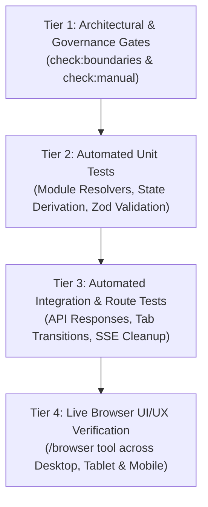

# PHASE 1 — TEST STRATEGY & REGRESSION MATRIX

> **Document 8 of 9:** QA Verification, Regression Matrix & Browser Testing Strategy  
> **Repository:** BidWar Core Platform  
> **Status:** Test Strategy Specification — Approved for Documentation Only  
> **Canonical Target:** `docs/unified-fan-page/PHASE-1-TEST-STRATEGY.md`  

---

## 1. QUALITY ASSURANCE TIERS

The BidWar Unified Fan ecosystem requires verification across four strict quality tiers:

1. **Tier 1 — Architectural Governance:**
   - `pnpm run check:boundaries`: Enforces module boundary integrity between Auction, Cricket, Badminton, and Members.
   - `pnpm run check:manual`: Enforces the mandatory living documentation rule for `docs/BIDWAR_OPERATION_MANUAL.md`.
2. **Tier 2 — Automated Unit Tests (Vitest):**
   - Pure functional testing of product mode derivation, adaptive navigation logic, URL parsing, and discovery schema validation.
3. **Tier 3 — Automated Integration & Route Tests (Vitest & Supertest):**
   - Express route tests for `/api/fan/tournaments` and `/api/tournaments/:id/fan/context`.
   - Router component tests verifying that legacy URLs render without redirect loops.
4. **Tier 4 — Live Browser UI/UX Verification (`/browser` tool):**
   - Real-world DOM audits checking layout overflows, touch target sizing, cheer animations, and Web Audio synthesis.

---

## 2. FUNCTIONAL REGRESSION MATRIX

Every implementation phase must execute and pass the following test matrix:

| Test Case ID | `auctionEnabled` | `scoringEnabled` | `sport` | Live Status | Expected Navigation & Render Behavior |
|:---:|:---:|:---:|:---:|:---:|---|
| **REG-01** | `true` | `false` | `cricket` | Pre-Auction | Direct Auction view. Scoring tab hidden. Status: "Pre-Auction / Ready". |
| **REG-02** | `true` | `false` | `cricket` | Auction LIVE | Direct Auction view. Live bidding active, hammer timer countdown active. |
| **REG-03** | `false` | `true` | `cricket` | No Live Match | Direct Cricket scoring view. Auction tab hidden. Shows fixtures & standings. |
| **REG-04** | `false` | `true` | `cricket` | Match LIVE | Direct Cricket scoring view. Live mini-scoreboard active with ball-by-ball updates. |
| **REG-05** | `false` | `true` | `badminton` | Match LIVE | Direct Badminton scoring view. Category points table and live court scores visible. |
| **REG-06** | `true` | `true` | `cricket` | Auction LIVE, Match Idle | Both tabs visible. **Default tab: Auction**. Scoring tab shows match schedule. |
| **REG-07** | `true` | `true` | `cricket` | Auction Idle, Match LIVE | Both tabs visible. **Default tab: Scoring**. Shows live mini-scoreboard. |
| **REG-08** | `true` | `true` | `cricket` | Both LIVE | Both tabs visible. **Default tab: Auction** (bidding urgency). Scoring pill shows LIVE beacon. |
| **REG-09** | `true` | `true` | `cricket` | Neither LIVE | Both tabs visible. Default tab evaluated by date (today's schedule). |
| **REG-10** | `true` | `true` | `cricket` | Completed | Both tabs visible. Auction shows final squads; Scoring shows tournament winners & champion team. |
| **REG-11** | `false` | `false` | any | any | Renders safe BidWar "Tournament Unavailable" holding card. Zero runtime errors. |
| **REG-12** | `true` | `true` | `football` | any | Auction tab active. Scoring tab hidden with "Scoring Coming Soon" indicator. |

---

## 3. REALTIME & SSE LIFECYCLE TESTS

| Test ID | Scenario | Expected Lifecycle Behavior | Verification Method |
|---|---|---|---|
| **SSE-01** | User views Auction tab | Auction EventSource is connected; Scoring EventSource is closed. | Mock EventSource instance count === 1. |
| **SSE-02** | User switches to Scoring tab | Auction EventSource immediately closes; Scoring EventSource connects. | Verify `auctionEs.close()` called before `scoringEs` created. |
| **SSE-03** | Rapid tab switching (10 clicks) | Only the final selected module's EventSource remains active. Zero leaked connections. | EventSource pool count === 1. Zero memory leak. |
| **SSE-04** | Network disconnection & retry | Displays `DisplayConnectionBanner`; reconnects with exponential backoff. | Simulate offline event; verify banner toast. |
| **SSE-05** | Background tab throttling | Pauses UI updates; invalidates active cache on tab focus resumption. | Simulate `visibilitychange: hidden -> visible`. |

---

## 4. BROWSER UI/UX TESTING PROTOCOL (`/browser`)

When testing UI implementations in Phase 2, Phase 5, and Phase 6:
1. **Desktop Viewport (1440 x 900):**
   - Verify 3-column layout on Auction view (Player Hero / Bid Console / Squad List).
   - Check sticky sponsor ticker clearance at bottom of viewport.
2. **Tablet Viewport (768 x 1024):**
   - Verify 2-column layout and responsive header wrapping.
3. **Mobile Viewport (390 x 844 - iPhone 14 / Pixel 7):**
   - Verify single-column stacked layout.
   - Check that `UnifiedModuleNav` pills take full width without wrapping.
   - Verify that `Cheer Live` floating action button sits **52px** above the sponsor ribbon (`MOBILE_CHEER_BUTTON_CLEARANCE_PX`).
   - Audit horizontal scroll: `document.documentElement.scrollWidth <= window.innerWidth` (Zero horizontal overflow).

---

## 5. PERFORMANCE BENCHMARKS & BUDGETS

- **Largest Contentful Paint (LCP):** < 1.8 seconds on 4G network.
- **First Input Delay (FID):** < 80 milliseconds.
- **Cumulative Layout Shift (CLS):** < 0.05 during tab transitions.
- **Initial JS Bundle Size:** < 180 KB gzipped for the Unified Fan Page shell.

---

*End of Test Strategy Contract (Document 8 of 9).*
